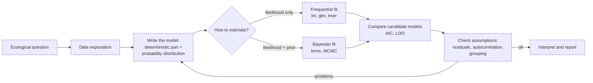

# Start Here

This is the knowledge bank for my Ecological Modeling course (BIOL580V, Dr. Caleb Roberts, Fall 2026). It teaches the course from first principles. Each note answers "what is X", and also "why do we do it this way, and what would go wrong if we didn't". It covers every session in the syllabus through Thu Oct 22 (Mixed models lab: Bayesian). The readings come first, and outside sources fill the gaps.

## The course in one paragraph
Ecologists collect messy data about living things and want to learn something true from it. A **model** is the tool for that: a simplified, written-down story of how the data came to be ([[MOC - Modeling Foundations]]). Before modeling, we look hard at the data ([[MOC - Data Exploration]]). Every statistical model has two parts. A deterministic part says what we expect on average, and a probability distribution says how real data scatter around that expectation ([[MOC - Probability and Distributions]], [[MOC - Linear Models and GLMs]]). We estimate the unknown numbers in the model either with likelihood alone (frequentist) or with likelihood plus prior knowledge (Bayesian, [[MOC - Bayesian Inference]]). We usually have several candidate stories, so we need a fair way to compare them ([[MOC - Model Selection]]). Real ecological data are rarely independent: nearby sites resemble each other ([[MOC - Autocorrelation]]) and repeated visits to the same site resemble each other ([[MOC - Mixed Models]]). Everything is done in R, reproducibly ([[MOC - R for Ecological Modeling]]).

## See it

*What to look at:* the loop from "Check assumptions" back to "Write the model". Modeling is a cycle, not a straight line.

## Where to go next
- **New to the maths or the symbols? Start with [[MOC - Basics from Zero]].**
- Then read [[How This Wiki Works]] and follow the [[Learning Path]].
- Have a problem to solve? Use the [[Problem-Solving Guide]].
- The units in order:
  - [[MOC - Modeling Foundations]]: what a model is and why we model
  - [[MOC - R for Ecological Modeling]]: loops, functions, tidyverse, RProjects, figures
  - [[MOC - Data Exploration]]: outliers, collinearity, zeros, independence
  - [[MOC - Probability and Distributions]]: the language of randomness
  - [[MOC - Linear Models and GLMs]]: from straight lines to counts and yes/no data
  - [[MOC - Bayesian Inference]]: priors, posteriors and MCMC
  - [[MOC - Model Selection]]: AIC, model weights, LOO
  - [[MOC - Autocorrelation]]: when nearby points resemble each other
  - [[MOC - Mixed Models]]: random effects, in lme4 and brms
- The "why" behind each rule: [[MOC - Why We Do It This Way]]
- Homework, project and schedule: [[MOC - Ecological Modeling Course]]
- The readings, in syllabus order: [[MOC - Course Readings]]
- Things I still need to find out: [[Open Questions]]
- Every note in one list: [[Index]]
- What changed and when: [[Change Log]]

## Right now
> [!important] Current focus
> Homework #4 (mixed models) is due Thu Oct 29, and the project final draft is due Nov 19. See [[Course Schedule]].
