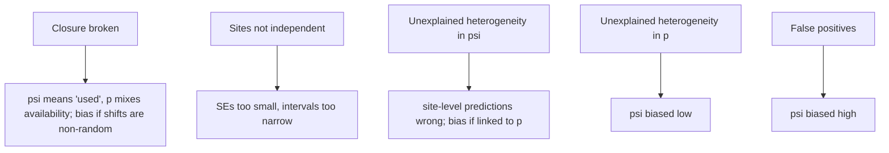

# Assumptions of Occupancy Models

> [!summary] In plain words
> a basic occupancy model makes four assumptions (closure within a season, independent sites, no unexplained differences in occupancy, no unexplained differences in detection) plus no false detections, and each one, when broken, damages the estimates in its own way.

## The question
What does an occupancy model assume, and what goes wrong when each assumption fails?

## Built from
- [[Closure Assumption]]: a site's status does not change within a season.
- [[Site Independence Assumption]]: sites carry separate evidence.
- [[Unexplained Heterogeneity in Occupancy]] and [[Unexplained Heterogeneity in Detection]]: differences are modelled or absent.
- [[Occupancy Likelihood]]: where each assumption is used.

## See it

*What to look at:* two failures bias ψ downward or upward, one shrinks the error bars, and the others change what ψ means or ruin the map.

## The reasoning, step by step
1. **Closure.** The species is present at occupied sites for the whole season; status can change between seasons, not within ([[Closure Assumption]]). Random movement in and out turns ψ into "proportion of sites used"; non-random shifts bias it.
2. **Independent sites.** Detecting the species at one site says nothing about another. Breaking it overstates the information: in the simulation in [[Site Independence Assumption]], reported SEs were 28% too small.
3. **No unexplained heterogeneity in occupancy.** ψ is equal across sites or explained by measured covariates. Breaking it mainly ruins site-level predictions ([[Unexplained Heterogeneity in Occupancy]]).
4. **No unexplained heterogeneity in detection.** p is equal across sites and surveys or explained by covariates. Breaking it biases ψ low: 0.44 against a truth of 0.60 in the simulation in [[Unexplained Heterogeneity in Detection]].
5. **No false positives.** Every detection is real. Misidentified tracks, calls or eDNA contamination push ψ up ([[Single-season Occupancy]]).
Each assumption is used in the likelihood: closure lets all K visits share one z; independence lets site probabilities multiply; the two homogeneity assumptions let one ψ and one p (or one covariate equation each) apply everywhere; no false positives lets a single 1 prove z = 1.

## So in practice
Plan around the assumptions before fieldwork: keep the season short for the species, space sites wider than a home range, measure what might change ψ and p, and use survey methods with certain identification. Then check fit with a parametric bootstrap and ĉ ([[Goodness of Fit and c-hat]]).

## What would go wrong otherwise
Running a "constant ψ, constant p" model because it converges, when observers, weather and habitat clearly changed detection: the estimate is then biased low and looks precise.

## Explain it back
- Which assumption, when broken, biases ψ low? Which biases it high? Which shrinks the error bars?

*Pass test:* you can name each assumption, say where it enters the likelihood, and predict the damage when it fails.

## Connections
- **Related:** [[Single-season vs Multi-season Occupancy]], [[Occupancy Workflow in R]], [[How many visits does an occupancy study need]]
- **Part of:** [[MOC 20 - Why We Do It This Way|MOC - Why We Do It This Way]], [[MOC 16 - Population Estimation|MOC - Population Estimation]]

## Flashcards

Name the four occupancy assumptions from the guest lecture.
??
Closure; independent sites; no unexplained heterogeneity in occupancy; no unexplained heterogeneity in detection.
++++

Which assumption failure biases ψ low, and which biases it high?
??
Unmodelled variation in p biases it low; false positives bias it high.
++++
