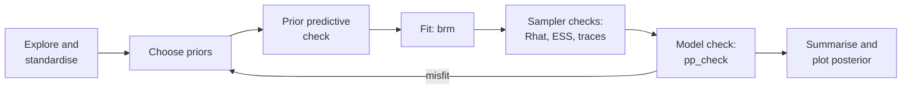

# Bayesian Linear Regression in R

> [!summary] In plain words
> a Bayesian regression in R follows a fixed sequence: explore and standardise, choose and test priors, fit with `brm()`, check the sampler, check the model, then summarise and plot the posterior.

## The question
What are the steps, start to finish, for fitting and reporting a Bayesian regression with brms?

## Built from
- [[brms]] and [[brm()]]: the fitting tool.
- [[Setting Priors in brms]] and [[Prior Predictive Check]]: priors.
- [[R-hat]], [[Effective Sample Size]], [[Trace Plot]]: sampler checks.
- [[Posterior Predictive Check]] and [[pp_check()]]: model check.
- [[Posterior Summary]], [[Credible Interval]], [[Posterior Draws]]: results.

## See it

*What to look at:* two different checks sit between fitting and interpreting.

## The reasoning, step by step
1. Plot the data. Standardise continuous predictors.
2. `get_prior()` to see the parameters. Choose weakly informative priors.
3. Fit with `sample_prior = "only"` and `pp_check()` to confirm that the priors imply plausible data.
4. Fit the model with `brm()`: 4 chains, a seed, and a `file` name so the fit is cached.
5. Read warnings. Check `Rhat` < 1.01 and adequate ESS. Look at `plot(fit)`.
6. `pp_check(fit)` with a few statistics relevant to the data.
7. `summary(fit)`: estimates and 95% credible intervals. Compute probabilities of direction from draws if needed.
8. `conditional_effects(fit)` or draws-based plots to show effects on the response scale with ribbons.
9. Report: model, family, priors, sampler settings, diagnostics, results.

## So in practice
```r
# norun (needs Stan)
library(brms)
d$tree_z <- as.numeric(scale(d$tree))
pri <- c(prior(normal(0, 2), class = "Intercept"), prior(normal(0, 1), class = "b"))
m0 <- brm(birds ~ tree_z, data = d, family = poisson(), prior = pri, sample_prior = "only"); pp_check(m0)
m1 <- brm(birds ~ tree_z, data = d, family = poisson(), prior = pri, chains = 4, cores = 4, seed = 1, file = "fits/m1")
summary(m1); plot(m1); pp_check(m1, type = "bars")
draws <- as_draws_df(m1); mean(draws$b_tree_z < 0)
conditional_effects(m1)
```

## What would go wrong otherwise
Jumping from `brm()` straight to `summary()` skips the two checks that tell you whether the summary means anything.

## Explain it back
- List the steps between `brm()` finishing and writing the results.

*Pass test:* you can carry out the workflow on a new dataset.

## Connections
- **Related:** [[How to check an MCMC fit]], [[How to choose a prior]], [[Prior Predictive vs Posterior Predictive Check]]
- **Part of:** [[MOC 20 - Why We Do It This Way|MOC - Why We Do It This Way]], [[MOC 09 - Bayesian Inference|MOC - Bayesian Inference]]

## Flashcards

What two kinds of check come between fitting a brms model and interpreting it?
??
Sampler diagnostics (R-hat, ESS, trace plots, warnings) and model checks (posterior predictive checks).
++++
