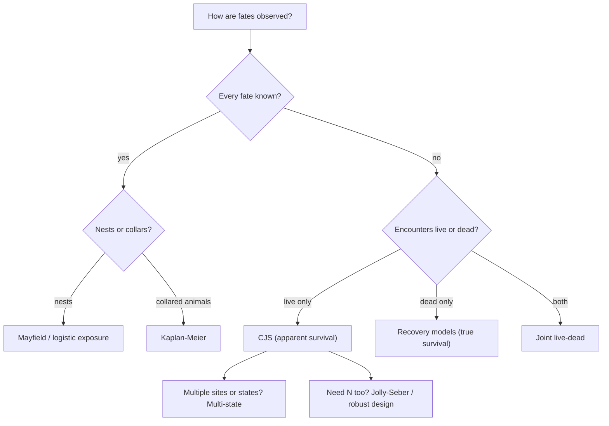

# Choosing a Survival Model

> [!summary] In plain words
> the right survival model depends on how fates are observed: known-fate models when every fate is known, CJS when live animals may be missed, recovery models when marked animals are found dead, and multi-state or joint models when movement must be separated from death.

## The question
Which survival model should I use for my data?

## Built from
- [[Known-fate Models]], [[Mayfield Nest Survival]], [[Kaplan-Meier Estimator]], [[Logistic Exposure Model]].
- [[Cormack-Jolly-Seber Model]], [[Dead Recovery Models]], [[Joint Live-dead Encounter Models]], [[Multi-state Models]], [[Robust Design]].

## See it

*What to look at:* the first branch is whether detection is 1.

## The reasoning, step by step
1. **Is every fate known at each check?** Yes: known-fate family.
   - Nests, constant risk: Mayfield or logistic exposure.
   - Animals, changing risk: Kaplan-Meier (staggered entry, censoring).
2. **Live encounters with imperfect detection?** CJS (apparent survival).
3. **Animals found dead (harvest)?** Brownie or Seber recovery models (true survival).
4. **Both live and dead?** Joint live-dead (survival and fidelity).
5. **Moving among sites or states?** Multi-state.
6. **Want abundance as well?** Jolly-Seber or the robust design.

## So in practice
Sketch how an animal could end up with a 0 in your data. Each route (dead, emigrated, missed, temporarily away) needs a parameter or an assumption.

## What would go wrong otherwise
Running a known-fate model on radio-collared animals while silently dropping the ones whose collars failed.

## Explain it back
- Which model for harvested waterfowl bands?

*Pass test:* you can pick a survival model from the data type.

## Connections
- **Related:** [[True vs Apparent Survival]], [[Mayfield vs Kaplan-Meier]], [[Choosing a Population Estimation Method]]
- **Part of:** [[MOC 20 - Why We Do It This Way|MOC - Why We Do It This Way]], [[MOC 16 - Population Estimation|MOC - Population Estimation]]

## Flashcards

Which survival model for live recaptures with imperfect detection?
??
Cormack-Jolly-Seber.
++++

Which for animals reported dead by hunters?
??
Dead recovery (Brownie or Seber) models.
++++
