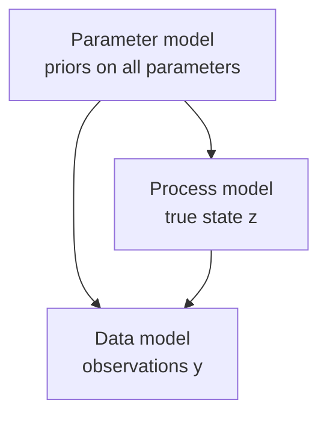

# Data Model, Process Model and Parameter Model

> [!summary] In plain words
> a hierarchical model separates how nature behaves (process), how we observe it (data) and what we assumed beforehand (parameters), and the posterior is proportional to the product of the three layers.

## The everyday picture
A play, a camera and a script. The play is what really happens on stage (process). The camera records it imperfectly (data). The script notes are what you knew before the curtain rose (parameters). Mixing up a camera fault with a twist in the plot gives a wrong account of the play.

## The question
How do the three layers fit together into one model, and why bother separating them?

## Built from
- [[Data Model]]: [y | z, θ_d].
- [[Process Model]]: [z | θ_p].
- [[Parameter Model]]: [θ_d] [θ_p].
- [[Latent Variable]]: z, the link between the first two.
- [[Hierarchical Model]] and [[Directed Acyclic Graph]]: the whole and its picture.

## See it

*What to look at:* observations depend on the true state and on observation parameters. The true state depends on process parameters. All parameters have priors.

## The reasoning, step by step
1. **Start with the science:** what is the true quantity z, and what drives it? That is the process model.
2. **Then the sampling:** given z, what would I record? That is the data model.
3. **Then priors** for every parameter in both.
4. **Multiply:** [z, θ | y] ∝ [y | z, θ_d] [z | θ_p] [θ_d] [θ_p].
5. **Fit by MCMC,** which returns posteriors for parameters and for the latent z.
6. **Why separate:** process variance and observation error have different consequences. Forecasts need the first only. Biological conclusions should be about z, not about y.
7. **Identifiability check:** the data must contain information to separate the layers, such as repeat visits.

**A worked example in numbers.** true abundance N ~ Poisson(λ = 50). Count y ~ Binomial(N, p = 0.4). Expected count 20. Reading y as abundance underestimates it by 60%.

## So in practice
Occupancy models, N-mixture models, state-space models and measurement-error models are all this template with different choices for the three layers.

## What would go wrong otherwise
Folding observation error into the process makes detection problems look like ecology: a habitat where animals are harder to see appears to have fewer animals.

## Explain it back
- Write the three layers for occupancy with imperfect detection.

*Pass test:* you can factor a described study into the three layers.

## Connections
- **Related:** [[Frequentist vs Bayesian Inference]], [[Why the posterior is proportional to likelihood times prior]]
- **Part of:** [[MOC 20 - Why We Do It This Way|MOC - Why We Do It This Way]], [[MOC 09 - Bayesian Inference|MOC - Bayesian Inference]]

## Flashcards

What are the three layers of a Bayesian hierarchical model?
??
Data model, process model and parameter model.
++++

Write the posterior of a hierarchical model in bracket notation.
??
[z, θ | y] ∝ [y | z, θ_d] [z | θ_p] [θ_d] [θ_p].
++++
