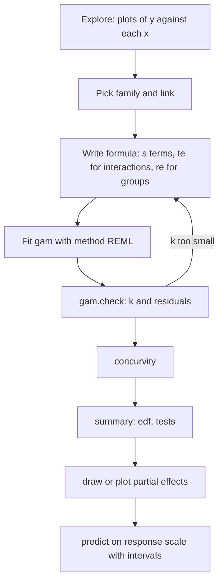

# GAM Workflow in R

> [!summary] In plain words
> fit a GAM by choosing the family, writing smooth terms with generous k, fitting with REML, checking k and residuals, checking concurvity, then interpreting partial effects and predictions on the response scale.

## The question
What are the steps from data to a reported GAM?

## Built from
- [[Generalized Additive Model]], [[Smoothing Function s()]], [[REML for Smoothness Selection]].
- [[Basis Dimension and gam.check()]], [[Concurvity]], [[Partial Effect Plots]], [[Prediction from a GAM]].

## See it

*What to look at:* the loop back to the formula when k is too small.

## The reasoning, step by step
1. **Explore** relationships and the response distribution.
2. **Family:** Poisson, negative binomial (`nb()`), binomial, Tweedie (`tw()`), Gaussian.
3. **Formula:** `s(x, k = ...)`, `te()` for interactions of different units, `s(g, bs = "re")` or fs for groups, cyclic for seasons.
4. **Fit** with `method = "REML"`.
5. **gam.check():** residual plots and k-index. Increase k if needed.
6. **concurvity(m, full = TRUE).**
7. **summary():** edf, significance of smooths, deviance explained.
8. **Plot** partial effects; derivatives if timing of change matters.
9. **Predict** on a grid, back-transform with intervals.

## So in practice
Report family, k for each smooth, method, edf and deviance explained, and show partial effect plots.

## In R
```r
library(mgcv); set.seed(28); d <- data.frame(cover = runif(300, 0, 100), doy = sample(100:200, 300, TRUE)); d$whistles <- rnbinom(300, mu = exp(2 + sin(d$cover / 25) - ((d$doy - 150) / 40)^2), size = 3)
m <- gam(whistles ~ s(cover) + s(doy), family = nb(), data = d, method = "REML"); round(summary(m)$s.table[, c("edf", "p-value")], 3); round(summary(m)$dev.expl, 2)
```

## What would go wrong otherwise
Reporting only p-values of smooths without plots.

## Explain it back
- What do you check after fitting and before interpreting?

*Pass test:* you can run the workflow on the course quail data.

## Connections
- **Related:** [[GLM vs GAM]], [[Why penalize wiggliness]], [[Choosing an HGAM Model Type]]
- **Part of:** [[MOC 20 - Why We Do It This Way|MOC - Why We Do It This Way]], [[MOC 15 - GAMs|MOC - GAMs]]

## Flashcards

What should you check after fitting a GAM before interpreting it?
??
gam.check() for k and residuals, and concurvity.
++++
