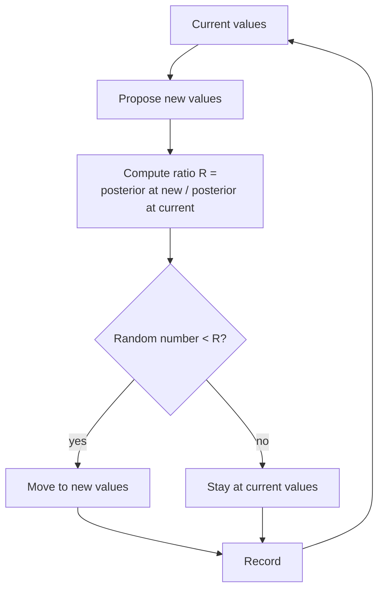

# How MCMC turns a formula into a posterior

> [!summary] In plain words
> MCMC needs only the ability to compute likelihood times prior at any parameter value, and by proposing moves and accepting them according to ratios of that product, it visits parameter values in proportion to their posterior probability.

## The everyday picture
A fog-bound hiker with an altimeter, mapping a mountain by walking it.

## The question
I wrote down a likelihood and priors. How does a computer get from that to thousands of posterior draws?

## Built from
- [[Normalizing Constant]]: the unknown the method avoids.
- [[Markov Chain]]: the walk.
- [[Proposal Distribution]] and [[Acceptance Rate]]: how each step is decided.
- [[Metropolis Algorithm]], [[Gibbs Sampling]], [[Hamiltonian Monte Carlo]]: three ways to step.
- [[Burn-in]], [[MCMC Chains]]: managing the run.
- [[Monte Carlo Integration]]: using the output.

## See it

*What to look at:* one loop of the Metropolis algorithm. The ratio needs only likelihood × prior.

## The reasoning, step by step
1. The posterior's shape is likelihood × prior. Its normalizing constant is unknown.
2. Start each chain at some initial values.
3. Propose a move.
4. Compare the unnormalised posterior at the new and current points. The constant cancels.
5. Move if it is better. If it is worse, move with probability equal to the ratio.
6. Record where you are. Repeat thousands of times.
7. The chain's visiting frequencies converge to the posterior.
8. Discard warm-up. Run several chains and check that they agree.
9. Treat the remaining draws as a sample from the posterior and summarise.
10. Gibbs replaces propose-and-accept with exact draws from full conditionals. HMC replaces blind proposals with gradient-guided trajectories.

| | Metropolis | Gibbs | HMC / NUTS |
|---|---|---|---|
| Proposal | Random step | Full conditional | Simulated trajectory |
| Accepts | Some | All | Most |
| Needs | Posterior up to a constant | Recognisable conditionals | Gradients, continuous parameters |
| Software | Hand-coded | JAGS, BUGS | Stan, brms |

## So in practice
You rarely code a sampler. You do need to recognise its settings (chains, iterations, warm-up) and its warning signs.

## What would go wrong otherwise
Treating the sampler as a black box leaves you unable to tell a model problem (non-identifiability) from an algorithm problem (bad tuning).

## Explain it back
- Explain why accepting some downhill moves is essential.

*Pass test:* you can narrate one Metropolis iteration and say how Gibbs and HMC differ.

## Connections
- **Related:** [[How to check an MCMC fit]], [[Why the posterior is proportional to likelihood times prior]]
- **Part of:** [[MOC - Why We Do It This Way]], [[MOC - Bayesian Inference]]

## Flashcards

Why must an MCMC sampler sometimes accept moves to lower posterior density?
??
Otherwise it would climb to the mode and stay there, instead of visiting values in proportion to their probability.
++++

What does Hamiltonian Monte Carlo need that Metropolis does not?
??
The gradient of the log posterior (and continuous parameters).
++++
