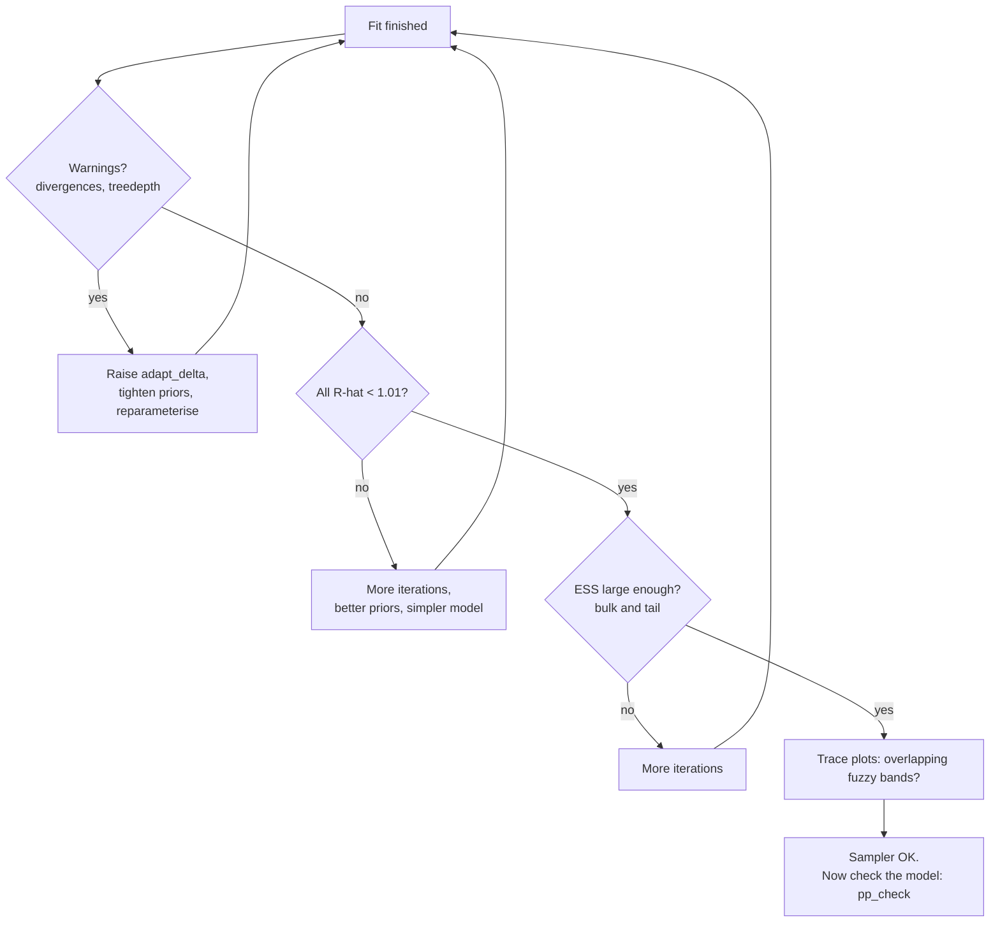

# How to check an MCMC fit

> [!summary] In plain words
> before reading any estimate from a Bayesian fit, confirm that the chains agree (R-hat), that there are enough effective draws (ESS), that trace plots look stable and that the sampler raised no warnings.

## The question
brms has finished sampling. What do I look at, in what order, before I trust the numbers?

## Built from
- [[MCMC Convergence]]: the goal.
- [[R-hat]]: do chains agree?
- [[Effective Sample Size]]: are there enough independent draws?
- [[Trace Plot]]: the visual check.
- [[Divergent Transitions]]: Stan's warning.
- [[Posterior Predictive Check]]: after the sampler is cleared, check the model.

## See it

*What to look at:* sampler checks first, model checks second.

## The reasoning, step by step
1. Read the warnings printed after sampling.
2. Scan the `Rhat` column. Anything above 1.01 needs attention.
3. Scan `Bulk_ESS` and `Tail_ESS`. Hundreds at least, preferably over 1,000.
4. Open `plot(fit)`. Chains should overlap and show no trend.
5. Pay special attention to standard deviations and correlations of group-level effects.
6. Only then run posterior predictive checks. A converged sampler says nothing about whether the model suits the data.
7. If problems persist after sensible fixes, suspect the model: too complex for the data, or non-identified.

## So in practice
```r
# norun (needs a brms fit)
summary(fit)                       # Rhat, Bulk_ESS, Tail_ESS
plot(fit)                          # trace and density plots
pp_check(fit, ndraws = 100)        # model check
```

## What would go wrong otherwise
Interpreting coefficients from unconverged chains is interpreting where the sampler happened to start.

## Explain it back
- What are the thresholds for R-hat and ESS?

*Pass test:* you can run through the checklist on any fit.

## Connections
- **Related:** [[How MCMC turns a formula into a posterior]], [[Prior Predictive vs Posterior Predictive Check]]
- **Part of:** [[MOC - Why We Do It This Way]], [[MOC - Bayesian Inference]]

## Flashcards

What four things should be checked before trusting MCMC output?
??
Sampler warnings (divergences), R-hat, effective sample size and trace plots.
++++
