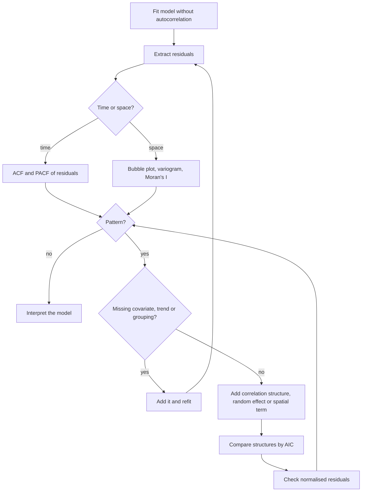

# How to detect and handle autocorrelation

> [!summary] In plain words
> fit the ordinary model first, check its residuals for temporal or spatial pattern, look for a missing covariate or grouping factor before anything else, and only then add a correlation structure or spatial term and check that it worked.

## The question
My data were collected across sites and years. What exactly do I do about autocorrelation?

## Built from
- [[Residual Autocorrelation]]: what is checked.
- [[Autocorrelation Function]], [[Variogram]], [[Correlogram]], [[Bubble Plot of Residuals]]: detection tools.
- [[Generalized Least Squares]], [[Correlation Structure]], [[Random Effect]], [[Spatial Eigenvector Filtering]], [[Conditional Autoregressive Model]]: remedies.
- [[AIC]]: choosing among structures.

## See it

*What to look at:* the loop back from the remedy to the residual check.

## The reasoning, step by step
1. **Identify the dimension:** time (years, visits), space (coordinates), groups (sites, individuals), or several.
2. **Fit the model without any correlation.**
3. **Check residuals:** ACF/PACF in time, bubble plot plus variogram or Moran's I in space. DHARMa tests for GLMs.
4. **No pattern:** proceed. Autocorrelation in the response alone is not a problem.
5. **Pattern:** first ask whether a covariate, trend or grouping factor is missing (Zuur Ch7.5). Fix that if you can.
6. **Then model the remaining dependence:** a random effect for repeated units, `corAR1` or `corARMA` for time, `corExp` and friends for space, or a smooth of time or coordinates, SAR/CAR or eigenvectors.
7. **Compare structures with AIC** (same fixed effects, REML for gls).
8. **Validate:** normalised residuals should show no remaining pattern. Report the fitted structure.

## So in practice
Keep the residual plot before and after the fix. Both belong in an appendix.

## What would go wrong otherwise
Adding corExp because "spatial data need it" without checking residuals, or stopping at a significant Moran's I without looking for a missing covariate.

## Explain it back
- What should you check before adding a correlation structure?

*Pass test:* you can run the whole workflow on your own data.

## Connections
- **Related:** [[OLS vs GLS]], [[Why residual autocorrelation can mean a missing covariate]], [[Autocorrelation as Signal or Nuisance]], [[Temporal vs Spatial Autocorrelation]]
- **Part of:** [[MOC 20 - Why We Do It This Way|MOC - Why We Do It This Way]], [[MOC 13 - Autocorrelation|MOC - Autocorrelation]]

## Flashcards

What is the first thing to check when residuals show autocorrelation?
??
Whether a covariate, trend or grouping factor is missing from the model.
++++

How do you confirm a correlation structure fixed the problem?
??
Check that the normalised residuals no longer show autocorrelation.
++++
