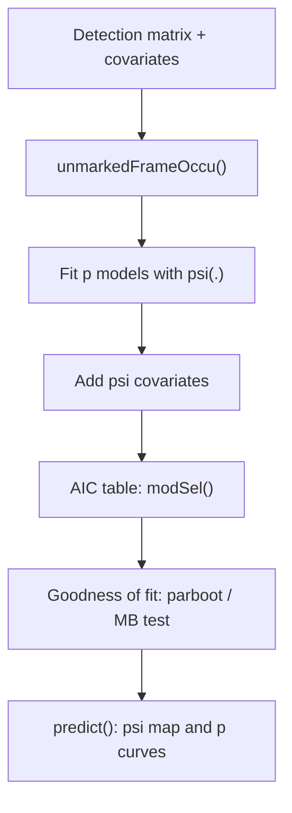

# Occupancy Workflow in R

> [!summary] In plain words
> an occupancy analysis in R goes from a site-by-visit detection matrix and covariates, through fitting candidate models for ψ and p, to checking fit, comparing models and predicting occupancy across the landscape.

## The question
What are the steps of an occupancy analysis in R?

## Built from
- [[Detection History]], [[Site Covariates]], [[Observation Covariates]].
- [[unmarked Package]] and [[Single-season Occupancy]].
- [[AIC]] and [[Goodness of Fit and c-hat]].

## See it

*What to look at:* detection is settled first because a wrong p model distorts ψ.

## The reasoning, step by step
1. **Build the detection matrix** y (sites × visits, NA for missed visits).
2. **Standardize covariates;** site covariates in a data frame, visit covariates as site × visit matrices.
3. **Create the frame:** `unmarkedFrameOccu(y, siteCovs, obsCovs)`.
4. **Fit candidates:** settle the detection model first, holding occupancy simple (ψ(.)) or, as [[Happe et al. 2020]] did, fixed at a global model, then add occupancy covariates to the chosen detection model.
5. **Compare with AIC** (`fitList()` and `modSel()`).
6. **Check fit:** `parboot()` or the MacKenzie-Bailey test (AICcmodavg `mb.gof.test`), giving ĉ; if ĉ > 1, rank models by [[QAIC]] and inflate standard errors by √ĉ (Happe et al.: ĉ = 1.37).
7. **Predict:** `predict(m, type = "state", newdata)` for ψ maps, `type = "det"` for p.
8. **Report** naive occupancy, ψ̂ and p̂ with intervals, and the model table.

## So in practice
Write the detection matrix code first and check it with `summary(umf)`: number of sites with at least one detection should equal your naive occupancy count.

## In R
```r
# norun (unmarked is not installed here; base-R fit in [[Single-season Occupancy]])
library(unmarked)
umf <- unmarkedFrameOccu(y = y, siteCovs = sc, obsCovs = list(wind = wind))
m0 <- occu(~ 1 ~ 1, umf); m1 <- occu(~ wind ~ 1, umf); m2 <- occu(~ wind ~ forest, umf)
modSel(fitList(null = m0, p_wind = m1, full = m2))
gof <- parboot(m2, statistic = function(f) sum(residuals(f)^2, na.rm = TRUE), nsim = 200)
predict(m2, type = "state", newdata = data.frame(forest = seq(0, 1, 0.1)))
```

## What would go wrong otherwise
Adding many covariates to ψ while leaving p constant, so habitat effects on visibility appear as habitat effects on occupancy.

## Explain it back
- Why fit detection models first?

*Pass test:* you can run an occupancy analysis end to end.

## Connections
- **Related:** [[Site vs Observation Covariates]], [[How many visits does an occupancy study need]], [[Assumptions of Occupancy Models]], [[Choosing Occupancy Software]], [[Fisher Occupancy Case Study]]
- **Part of:** [[MOC 20 - Why We Do It This Way|MOC - Why We Do It This Way]], [[MOC 16 - Population Estimation|MOC - Population Estimation]], [[MOC 03 - R for Ecological Modeling|MOC - R for Ecological Modeling]]

## Flashcards

In an occupancy workflow, why settle the detection model first?
??
A misspecified p distorts ψ estimates and covariate effects.
++++
