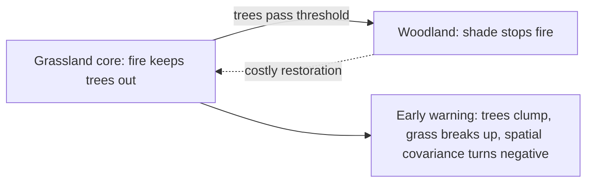

# Regime Shifts and Spatial Early Warning Signals

> [!summary] In plain words
> A grassland held open by fire and a juniper woodland that stops fire are two stable states of the same land; crossing from one to the other is a regime shift, and it is hard to undo. Because undoing it is expensive, ecologists look for warnings in the map pattern, such as trees clumping, before the flip. The grassland bird project uses one such pattern, spatial covariance, as a snapshot of habitat, not as a warning over time.

## The question
Why do Dr. Roberts' group and Berry et al. care so much about spatial covariance and grassland cores, and what can a one-year snapshot say about them?

## Built from
- [[Regime Shift]]: the flip between two self-maintaining states
- [[Feedback Loops in Ecology]]: what holds each state in place
- [[Spatial Early Warning Signal]]: map-pattern changes that hint a flip is coming
- [[Spatial Covariance]]: the pattern measure used in the project
- [[Grassland Core Habitat]]: intact grassland still held by its fire feedback

## See it

*What to look at:* the solid arrow is easy to cross once the threshold is passed; the dashed way back is expensive, which is why a warning matters.

## The reasoning, step by step
1. **Grassland and woodland are alternative states,** each held in place by feedbacks: grass fuels fire that kills seedlings; trees shade out grass and so starve the fire ([[Ecological Resilience and Alternative States]]).
2. **So a flip is hard to reverse.** *Why:* once trees pass a threshold they suppress the fire that would remove them, so getting back takes far more effort than preventing the shift ([[Woody Encroachment]]).
3. **So managers want warning before the flip.** *Why:* prevention is cheap and restoration is costly, which is the logic of [[Defend the Core]].
4. **Theory says patterns change near a threshold.** Rising patchiness, neighbouring cells becoming more alike ([[Spatial Autocorrelation]]), changing spatial covariance and moving or sharpening grass-tree boundaries can all appear before the average cover looks alarming.
5. **Spatial covariance marks boundaries.** Negative values mark places where grass and tree cover trade off sharply, a tree-grass edge ([[Why negative spatial covariance marks a tree-grass boundary]]).

**A worked example in numbers.** A 5 × 5 grid goes from 2 scattered tree cells (8% cover) to 8 tree cells in 2 clumps (32%). The average quadrupled, but the warning is the arrangement: clumps forming and joining.

## So in practice
In the project, spatial covariance at each point is a predictor in the habitat models (H2, fitted Oct 13). As H2 predicted, focal grassland richness was higher toward core-like values and all-species richness higher toward edges ([[Hypotheses]], [[Preliminary Results]]). Flooded pixels were removed before computing it because standing water "could interfere with regime shift signals" ([[Flood Masking]], [[Roberts et al. 2025]]). A related idea is in [[Batpurev et al. 2021]], on where people judge a rangeland to have "collapsed" as cover falls.

## What would go wrong otherwise
- You would call any big change a regime shift, when the mark is feedbacks that hold the new state and resist reversal.
- You would watch only average tree cover and miss the pattern change that comes first.
- You would claim the project detects a shift, though it has one year per site and no time series ([[Why site and year cannot be separated]]); it uses spatial covariance as a habitat snapshot.
- You would attribute specific signals or thresholds to Berry et al. or Dr. Roberts' group without checking the papers ([[Berry et al. 2026]]).

## Connections
- **Related:** [[Regime Shift]], [[Spatial Early Warning Signal]], [[Feedback Loops in Ecology]], [[Ecological Resilience and Alternative States]], [[Why trees take over grasslands without fire]], [[Defend the Core]]
- **Part of:** [[MOC 20 - Why We Do It This Way|MOC - Why We Do It This Way]], [[MOC 24 - Grassland Bird Ecology|MOC - Grassland Bird Ecology]]
- **Go deeper:** [[Berry et al. 2026]], [[Batpurev et al. 2021]], [[Roberts et al. 2025]]

## Flashcards

Can the grassland bird data detect a regime shift happening? Why or why not?
??
No. Each site was surveyed in only one year, so there is no time series. Spatial covariance is used as a snapshot of habitat at each point, not as a warning signal over time.
++++

Why does the regime-shift idea favour protecting intact cores first?::Because once woodland has taken over, feedbacks make restoration costly, while keeping a core whose fire feedback still works is cheap.
