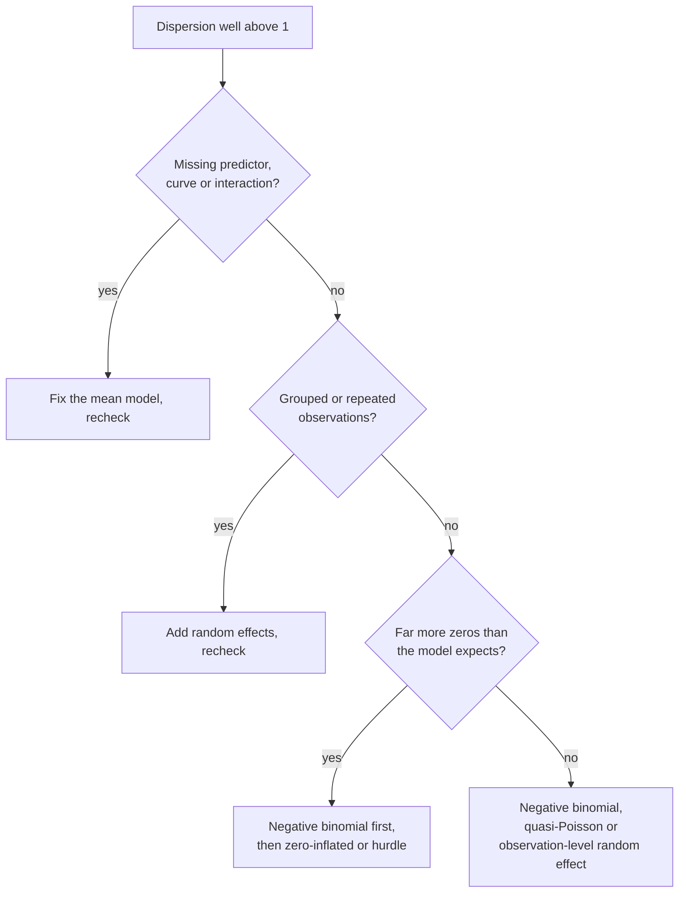

# What to do about overdispersion

> [!summary] In plain words
> when counts scatter more than a Poisson allows, first look for a fixable cause in the mean model, then choose a model whose variance can stretch, because leaving it alone makes every standard error too small.

## The question
My Poisson model has a dispersion statistic of 4. What are my options, in what order, and how do I choose?

## Built from
- [[Overdispersion]]: the problem.
- [[Pearson Residuals]] and [[Dispersion Parameter]]: detecting it.
- [[Negative Binomial GLM]], [[Quasi-Poisson]], [[Observation-level Random Effect]]: variance fixes.
- [[Zero-inflated Model]]: when zeros are the cause.
- [[Random Effect]]: when grouping is the cause.

## See it

*What to look at:* variance fixes come last. The first three questions look for structure the model is missing.

## The reasoning, step by step
1. **Confirm it.** Dispersion = Σ Pearson² / residual df, or a simulated-residual dispersion test.
2. **Look for apparent overdispersion.** Plot residuals against every predictor. An outlier, a missing covariate or an untreated curve all inflate the statistic.
3. **Look for grouping.** Several counts from one site or year share unmeasured influences. Add a random effect.
4. **Look at zeros.** Compare observed zeros with those the fitted model predicts.
5. **Otherwise change the variance model.** Negative binomial (variance grows with μ²) or quasi-Poisson (variance proportional to μ). Plot squared residuals against fitted means to see which shape fits.
6. **Prefer negative binomial when you need a likelihood** (AIC, simulation, prediction intervals). Quasi-Poisson only rescales standard errors.
7. **Recheck the new model.** A negative binomial can still be zero-inflated or have a wrong mean.

**A worked example in numbers.** Poisson slope 0.73, SE 0.11, z = 6.5. Dispersion 3.5. Corrected SE = 0.11 × √3.5 = 0.21, z = 3.5. Same estimate, far weaker certainty.

## So in practice
In R: `glm(..., family = poisson)` then the dispersion check, then `MASS::glm.nb()` or `glmmTMB(..., family = nbinom2)`, then residual checks again.

## What would go wrong otherwise
Ignoring a dispersion of 4 halves every standard error (√4 = 2). Effects that are noise look significant, and model selection favours overly complex models.

## Explain it back
- Give the order of questions to ask before changing the distribution.

*Pass test:* you can go from a dispersion statistic to a defensible model.

## Connections
- **Related:** [[Poisson vs Negative Binomial]], [[Zero-inflated vs Hurdle Model]], [[Model Validation]]
- **Part of:** [[MOC 20 - Why We Do It This Way|MOC - Why We Do It This Way]], [[MOC 08 - Generalized Linear Models|MOC - Generalized Linear Models]]

## Flashcards

What should you check before switching distribution to fix overdispersion?
??
Whether it is caused by a missing predictor, nonlinearity, outliers, grouping structure or excess zeros.
++++

By what factor does overdispersion φ understate Poisson standard errors?
??
√φ.
++++
