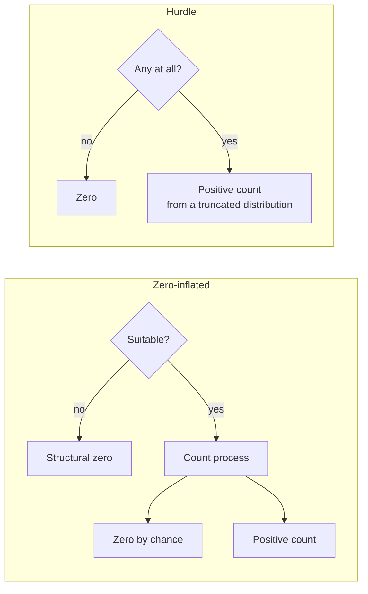

# Zero-inflated vs Hurdle Model

> [!summary] In plain words
> both handle counts with too many zeros using two parts, but a zero-inflated model allows zeros from two sources (structural and by chance) while a hurdle model sends every zero through a single yes/no gate.

## The question
I have lots of zeros. Should I use a zero-inflated model or a hurdle model, and how do their parts differ in meaning?

## Built from
- [[Zero Inflation]]: the symptom.
- [[Zero-inflated Model]]: mixture of structural zeros and a count distribution.
- [[Hurdle Model]]: binary part plus zero-truncated counts.
- [[Truncated Distribution]] and [[Mixture Distribution]]: the constructions.

## See it

*What to look at:* the zero-inflated side has two routes to zero. The hurdle side has one.

## The reasoning, step by step
1. **Zero-inflated:** some sites can never have the species. The others have a count that may happen to be zero.
2. **Hurdle:** first, is the count zero or not? Second, if not, how big?
3. **Meaning of the binary part differs.** Zero-inflated: probability of a structural zero. Hurdle: probability of any non-zero count.
4. **Meaning of the count part differs.** Zero-inflated: abundance where suitable, zeros included. Hurdle: abundance given presence.
5. **Choose by the science.** Two kinds of zero that you want to separate (unsuitable habitat versus present but missed or absent by chance): zero-inflated. One process deciding presence and another deciding amount: hurdle.
6. **Hurdles can also fit too few zeros.** Zero-inflated models can only add zeros.
7. **Check a plain negative binomial first.** It often handles the zeros on its own.

## So in practice
`glmmTMB(y ~ x, ziformula = ~ z, family = nbinom2)` for zero-inflated. `glmmTMB(y ~ x, ziformula = ~ z, family = truncated_nbinom2)` for a hurdle. Compare by AIC and by how well simulated data reproduce the zeros.

## What would go wrong otherwise
Reading zero-part coefficients as "presence" in a zero-inflated model reverses their sign. Fitting either when a negative binomial suffices adds parameters the data can't support.

## Explain it back
- Where can zeros come from in each model?

*Pass test:* you can pick one for a described study and justify it.

## Connections
- **Related:** [[What to do about overdispersion]], [[Poisson vs Negative Binomial]], [[Occupancy|Occupancy Model]]
- **Part of:** [[MOC - Why We Do It This Way]], [[MOC - Generalized Linear Models]]

## Flashcards

Main difference between zero-inflated and hurdle models?
??
Zero-inflated models have two sources of zeros (structural and count process). Hurdle models have one: the binary part.
++++
