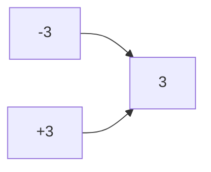

# Absolute Value

Walk 3 blocks east or 3 blocks west: either way you walked 3 blocks. The **absolute value** of a number is its distance from zero with the direction dropped. It is written with two bars, |x|, read "the absolute value of x". So |−3| = 3 and |3| = 3. Positive numbers stay as they are, negative numbers lose their minus sign, and the result is never negative. Watch the common slip here: |−x| equals |x|, not −x.

Absolute values solve a real problem in statistics. Take the values 2, 3, 3, 5 and 7, whose [[Mean]] is 4. Each value's *[[Deviation|deviation]]* is how far it sits from the mean: −2, −1, −1, +1 and +3. Try to measure the spread by adding these up and you get exactly 0. That always happens, because the mean is the balance point, so the negative deviations always cancel the positive ones. To measure spread you have to stop them cancelling. Taking absolute values does that: 2, 1, 1, 1 and 3 add to 8, and the *mean absolute deviation* is 8 / 5 = 1.6. Squaring is the other way to remove signs, and it is the one [[Frequentist Inference|classical statistics]] prefers ([[Variance]], [[Sum of Squares]]). Squares give a different answer (the [[Standard Deviation|standard deviation]] here is 2.0, larger because squaring weights big deviations more), and they are smoother for the maths, because the absolute value has a sharp corner at zero that makes calculus awkward.

Many questions in modeling are about how big, not which way: how far off a prediction was, how strong a relationship is, how large an effect is. Absolute value answers those. You will meet it in rules of thumb such as "worry about [[Collinearity]] when |r| > 0.7", which means a [[Correlation]] stronger than 0.7 in either direction, and "|t| > 2 is a rough flag" for a [[Regression Coefficient|coefficient]] ([[Zuur et al. 2010]]). Sometimes, though, the direction is the whole point: an overestimate and an underestimate of the same size can be very different mistakes, and dropping the sign would hide that.


*What to look at:* two different numbers, one distance from zero.

```r
x <- c(2, 3, 3, 5, 7)
dev <- x - mean(x)
sum(dev)              # 0: signed deviations cancel
abs(dev)              # 2 1 1 1 3
mean(abs(dev))        # 1.6, the mean absolute deviation
```
`abs()` is the absolute value function.

## Connections
- **Builds on:** [[Mean]], [[Deviation]], [[Standard Deviation]]
- **Leads to:** [[Variance]], [[Sum of Squares]], [[Correlation]], [[Frequentist Inference]], [[Regression Coefficient]]
- **See also:** [[Variable]]
- **Part of:** [[MOC 01 - Basics from Zero|MOC - Basics from Zero]]

## Flashcards

What is the absolute value of a number?
??
Its distance from zero, with the sign dropped.
++++

Why can't you measure spread by adding up deviations from the mean?
??
Positive and negative deviations cancel to exactly zero.
++++

What does |r| > 0.7 mean?
??
The correlation is stronger than 0.7 in either direction.
++++
