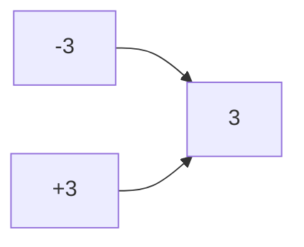

# Absolute Value

**In one line:** the absolute value of a number is its distance from zero, ignoring whether it is positive or negative.

> [!info] Before this, it helps to know
> [[Variable]] (numbers in a column) · [[Mean]] (the centre of the data)

## The everyday picture
Walking 3 blocks east or 3 blocks west. Either way you walked 3 blocks. Absolute value is the distance walked, with the direction dropped.

*Where the picture stops working:* sometimes the direction is the point. An overestimate and an underestimate are different mistakes even if they are the same size.

## Words you'll need
- **|x|:** read "the absolute value of x".
- **Sign:** whether a number is positive or negative.
- **Deviation:** an observation minus the mean.

## A tiny example
Deviations from a mean of 4 for the values 2, 3, 3, 5, 7: −2, −1, −1, +1, +3.
- They sum to **0**, which says nothing about spread.
- Absolute values: 2, 1, 1, 1, 3. They sum to **8**.
- Mean absolute deviation = 8 / 5 = **1.6**.

## Start from zero
1. **Take a number.** −2.
2. **Drop its sign.** |−2| = 2. Positive numbers stay as they are.
3. **Use it when size matters and direction doesn't.** *Why:* deviations always cancel to zero, so to measure spread you must stop them cancelling.
4. **Squaring is the other way to remove signs.** [[Variance]] squares instead, because squares are smoother to do maths with.

## See it

*What to look at:* two different numbers, one distance from zero.

## Why it is this way
Many questions are about how big, not which way: how far off was the prediction, how strong is the correlation, how large is the effect. Absolute value answers those. It is used less than squaring in classical statistics only because its sharp corner at zero makes calculus awkward.

## In R
```r
x <- c(2, 3, 3, 5, 7)
dev <- x - mean(x)
sum(dev)              # 0: signed deviations cancel
abs(dev)              # 2 1 1 1 3
mean(abs(dev))        # 1.6, the mean absolute deviation
```
`abs()` is the absolute value function.

## In the course
Absolute values appear in rules such as "worry when |r| > 0.7" for [[Collinearity]] and in t-statistics, where |t| > 2 is a rough flag ([[Zuur et al. 2010]]).

## Common confusions
- **"|x| makes things positive, so |−x| = −x."** |−x| = |x|. The result is never negative.
- **"Mean absolute deviation equals standard deviation."** They are different measures. SD here is 2.0, larger because squaring weights big deviations more.

## Explain it back
- Why do deviations from the mean always sum to zero?
- When would you care about the sign of an error?

*Pass test:* you can explain why spread is measured with absolute or squared deviations.

## Connections
- **Builds on:** [[Mean]]
- **Leads to:** [[Variance]], [[Sum of Squares]], [[Correlation]]
- **Part of:** [[MOC 01 - Basics from Zero|MOC - Basics from Zero]]

## Flashcards

What is the absolute value of a number?
??
Its distance from zero, with the sign dropped.
++++

Why can't you measure spread by adding up deviations from the mean?
??
Positive and negative deviations cancel to exactly zero.
++++

What does |r| > 0.7 mean?
??
The correlation is stronger than 0.7 in either direction.
++++
