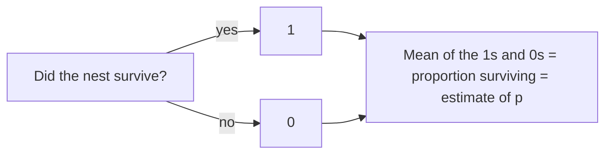

# Binary Variable

Think of a light switch: on or off, nothing in between. A **binary variable** has only two possible values, such as alive or dead, present or absent, burned or unburned. Did the nest survive? Was the frog heard? Each is a switch. Binary data are the simplest kind of [[Discrete Data]], and they are usually *coded* as 1 for the outcome you chose to count and 0 for the other. The 1 does not have to mean "good"; it just marks the outcome you are counting, and it could equally be "died".

Coding as 1 and 0 has a lovely payoff. Five nests are recorded as survived = 1, 0, 1, 1, 0. The sum, 3, counts the survivors, and the mean, 3 / 5 = 0.6, is the proportion that survived, which is the natural estimate of the *probability* p that a nest survives. In ecology each switch has a chance of being on, and that chance is what you model. One yes-or-no outcome with chance p follows the [[Bernoulli Distribution]]; the number of yeses out of n tries follows the binomial ([[Binomial Sampling]]). Do not mix up the two words: *binary* describes one yes/no outcome, *binomial* the count of yeses among n of them.

Why does recognising a binary response matter so much? Because a straight-line model ignores the fact that a probability must stay between 0 and 1. Fit a [[Equation of a Line|straight line]] to survival against nest height and it may predict 1.3 or −0.2 for some nest, and neither is a possible probability. So binary responses get [[Logistic Regression]], which passes the straight line through a [[Link Function]] (the [[Logit Link|logit]]) that keeps every prediction between 0 and 1. Many of the most important questions in ecology are yes-or-no questions in disguise: survival and detection in Powell and Gale ([[Powell and Gale 2015 Ch3]]), occupancy, and presence or absence of a parasite, all of which are handled in the GLM unit ([[MOC 06 - Linear Models and GLMs|MOC - Linear Models and GLMs]]).


*What to look at:* coding as 1/0 turns "how often?" into a simple average.

```r
survived <- c(1, 0, 1, 1, 0)
mean(survived)                               # 0.6: proportion that survived
fit <- glm(survived ~ 1, family = binomial)  # logistic regression with no predictors
plogis(coef(fit))                            # 0.6 back on the probability scale
```

## Connections
- **Builds on:** [[Discrete Data]], [[Equation of a Line]]
- **Leads to:** [[Bernoulli Distribution]], [[Binomial Sampling]], [[Logistic Regression]], [[Link Function]], [[Logit Link]]
- **Part of:** [[MOC 01 - Basics from Zero|MOC - Basics from Zero]], molecular note [[Continuous vs Discrete Data]]
- **Go deeper:** [[Powell and Gale 2015 Ch3]]

## Flashcards

What is a binary variable, and how is it usually coded?
??
A variable with only two outcomes (alive/dead, present/absent), coded 1 and 0.
++++

Why is the mean of a 0/1 variable useful?
??
It equals the proportion of 1s, which is the natural estimate of the probability of a 1.
++++
