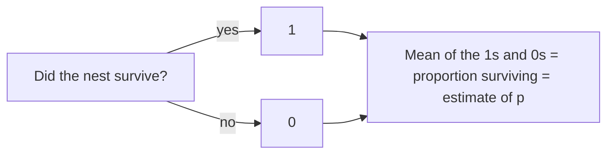

# Binary Variable

**In one line:** a binary variable has only two possible values, such as alive or dead, present or absent, usually coded 1 and 0.

> [!info] Before this, it helps to know
> [[Discrete Data]] (binary is the simplest discrete case)

## The everyday picture
A **light switch**: on or off, nothing in between. Did the nest survive? Was the frog heard? Is the plot burned? Each is a switch.

*Where the picture stops working:* a switch has no "chance" attached. In ecology each switch has a probability of being on, and that probability is what you model.

## Words you'll need
- **Binary:** two possible values.
- **Coding 1/0:** writing the "yes" outcome as 1 and the "no" as 0.
- **Probability (p):** the chance the outcome is 1.
- **Bernoulli distribution:** the distribution of one yes/no outcome with chance p ([[Bernoulli Distribution]]).
- **Logistic regression:** the usual model for a binary response ([[Logistic Regression]]).

## A tiny example
Five nests: survived = 1, 0, 1, 1, 0.
- The mean of the 0s and 1s is 3 / 5 = **0.6**. *Why that's handy:* the mean of a 1/0 variable is the proportion of 1s, the natural estimate of p.
- A straight-line model could predict 1.3 or −0.2 for some nest. Neither is a possible probability, which is why binary responses get logistic regression instead.

## Start from zero
1. **Some outcomes are yes or no.** Survived or not, present or not.
2. **Code them 1 and 0.** *Why:* then sums count the yeses and means give the proportion.
3. **What you model is the chance of a 1.** It must stay between 0 and 1.
4. **One yes/no outcome follows a Bernoulli distribution;** the count of yeses out of n follows a binomial ([[Binomial Sampling]]).
5. **So binary responses need models that keep predictions between 0 and 1.** That's what the logit link in logistic regression does ([[Link Function]]).

## See it

*What to look at:* coding as 1/0 turns "how often?" into a simple average.

## Why it is this way
Many of the most important ecological questions (survival, occupancy, detection) are yes/no questions. Recognising a binary response early saves you from fitting a straight line that predicts impossible probabilities.

## In R
```r
survived <- c(1, 0, 1, 1, 0)
mean(survived)                               # 0.6: proportion that survived
fit <- glm(survived ~ 1, family = binomial)  # logistic regression with no predictors
plogis(coef(fit))                            # 0.6 back on the probability scale
```

## In the course
Binary data are the basis of survival and detection estimation in Powell and Gale ([[Powell and Gale 2015 Ch3]]) and of logistic regression in the GLM unit ([[MOC 06 - Linear Models and GLMs|MOC - Linear Models and GLMs]]).

## Common confusions
- **Binary vs binomial.** Binary is one yes/no outcome; binomial is the count of yeses out of n tries.
- **"1 must mean good."** 1 just marks the outcome you chose to count. It could be "died".

## Explain it back
- Use a light switch to explain a binary variable.
- Why is the mean of 1s and 0s the proportion of 1s?
- Why can't a straight-line model be trusted for binary data?

*Pass test:* you can code a yes/no field outcome and estimate its probability by hand.

## Connections
- **Builds on:** [[Discrete Data]]
- **Leads to:** [[Bernoulli Distribution]], [[Binomial Sampling]], [[Logistic Regression]], [[Link Function]]
- **Part of:** [[MOC 01 - Basics from Zero|MOC - Basics from Zero]], molecular note [[Continuous vs Discrete Data]]
- **Go deeper:** [[Powell and Gale 2015 Ch3]]

## Flashcards

What is a binary variable, and how is it usually coded?
??
A variable with only two outcomes (alive/dead, present/absent), coded 1 and 0.
++++

Why is the mean of a 0/1 variable useful?
??
It equals the proportion of 1s, which is the natural estimate of the probability of a 1.
++++
