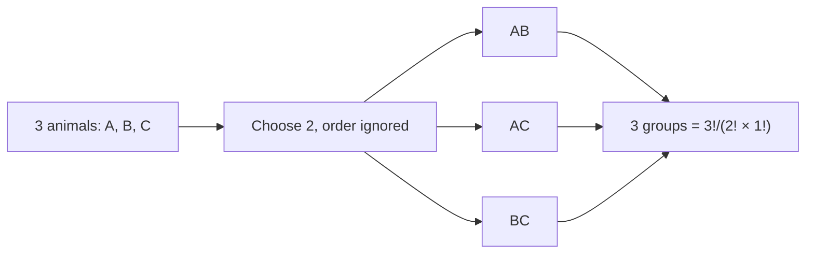

# Binomial Coefficient

**In one line:** the binomial coefficient $\binom{N}{n}$, read "N choose n", counts how many different groups of n you can pick from N things when order doesn't matter.

> [!info] Before this, it helps to know
> [[Factorial]] (the coefficient is built from factorials)

## The everyday picture
Three friends, Ana, Ben and Cai, and a car with two spare seats. How many different car-loads? Ana+Ben, Ana+Cai, Ben+Cai: **3**. "Ben+Ana" is the same car-load as "Ana+Ben", because who got in first doesn't matter. That count is "3 choose 2".

*Where the picture stops working:* in ecology the "car-load" is usually a pattern, such as *which* 5 of 20 collared sheep survived.

## Words you'll need
- **Combination:** a group where order doesn't matter.
- **$\binom{N}{n}$:** the number of combinations of n from N, equal to N! / (n!(N − n)!).
- **choose():** the R function for it.
- **Binomial probability:** the chance of exactly k successes in n tries ([[Binomial Sampling]]).

## A tiny example
**From queues to car-loads.** There are 3! = 6 queues of Ana, Ben and Cai. Take the first two people of each queue: AB, AC, BA, BC, CA, CB. Each car-load appears twice (AB and BA), because the two chosen can swap in 2! = 2 ways, and the one left out can be "arranged" in 1! = 1 way. So the number of car-loads is 6 / (2 × 1) = **3**.

**Bigger:** 20 collared sheep, 5 alive after a year. How many possible sets of 5 survivors? $\binom{20}{5} = \frac{20!}{5!\,15!}$ = **15,504**.

## Start from zero
1. **N! counts every full ordering of N things** ([[Factorial]]).
2. **But often only *who* is in the group matters.**
3. **In each ordering, the n chosen can be reshuffled n! ways and the rest (N − n)! ways without changing the group.**
4. **So divide those out:** $\binom{N}{n} = \frac{N!}{n!(N-n)!}$. *Why:* each group was counted n! × (N − n)! times.
5. **This count is the first piece of every binomial probability.** P(exactly k of n) = $\binom{n}{k} p^k (1-p)^{n-k}$: the number of patterns times the chance of any one pattern ([[Binomial Sampling]]).

## See it

*What to look at:* the formula counts the boxes at the end without drawing them.

## Why it is this way
Two-outcome field data (alive or dead, marked or not) are everywhere, and every binomial probability needs to know how many ways k successes could be arranged among n units. Listing them fails beyond tiny numbers; the formula never does. With survival p = 0.25, P(exactly 5 of 20 sheep survive) = 15,504 × 0.25⁵ × 0.75¹⁵ ≈ **0.202**.

## In R
```r
choose(3, 2)          # 3
choose(20, 5)         # 15504
choose(20, 5) * 0.25^5 * 0.75^15   # 0.2023: P(exactly 5 of 20)
dbinom(5, size = 20, prob = 0.25)  # same, from the built-in binomial
```

## In the course
Powell and Gale introduce it as the base of most estimators in their primer, using 20 coin tosses with 5 heads (15,504 ways) ([[Powell and Gale 2015 Ch3]], pp. 22 to 24).

## Common confusions
- **Combinations vs permutations.** Combinations ignore order; permutations count it.
- **"20 choose 5 is 15."** It's 15,504. "Choose" divides factorials; it doesn't subtract.

## Explain it back
- Use car-loads of friends to explain $\binom{3}{2} = 3$.
- Why divide by n! and (N − n)!?
- Why does a binomial probability need this count?

*Pass test:* you can find $\binom{4}{2}$ both by listing groups and by the formula, and get 6 both times.

## Connections
- **Builds on:** [[Factorial]]
- **Leads to:** [[Binomial Sampling]], [[Binomial Distribution]], [[Likelihood]]
- **Part of:** [[MOC 01 - Basics from Zero|MOC - Basics from Zero]], molecular note [[Factorials and Binomial Coefficient]]
- **Go deeper:** [[Powell and Gale 2015 Ch3]]

## Flashcards

What does "N choose n" count?
??
The number of different groups of n that can be picked from N things when order doesn't matter: N! / (n!(N − n)!).
++++

Why does the binomial probability formula include a binomial coefficient?
??
Every particular pattern with k successes has the same probability, so you multiply that probability by the number of such patterns (N choose k).
++++
