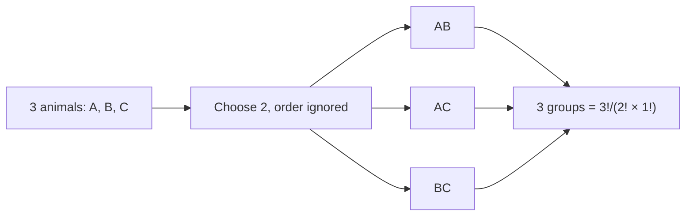

# Binomial Coefficient

Three friends, Ana, Ben and Cai, and a car with two spare seats. How many different car-loads are possible? Ana and Ben, Ana and Cai, Ben and Cai: 3. "Ben and Ana" is the same car-load as "Ana and Ben", because who got in first does not matter. The **binomial coefficient** counts exactly this: how many different groups of n you can pick from N things when order does not matter. A group where order does not matter is a *combination*. It is written $\binom{N}{n}$ and read "N choose n", so this car example is "3 choose 2" = 3. In R it is `choose(3, 2)`.

The formula comes from correcting an overcount. The number of ways to line up all N things in order is N! ([[Factorial]]); for our three friends that is 3! = 6 queues: ABC, ACB, BAC, BCA, CAB, CBA. Take the first two people of each queue as the car-load and you get AB, AC, BA, BC, CA, CB. Each car-load appears twice, because the two chosen people can swap places in 2! = 2 ways, and the one left out can be "arranged" in 1! = 1 way. So divide out those reshufflings: $\binom{N}{n} = \frac{N!}{n!(N-n)!}$, here 6 / (2 × 1) = 3. For something bigger: 20 collared sheep, 5 alive after a year. The number of possible sets of 5 survivors is $\binom{20}{5}$ = 20! / (5! × 15!) = 15,504. Note that "choose" divides factorials; "20 choose 5" is 15,504, not 15. Counting with order mattering (permutations) would give a far larger number.

Why does a modeler need this count? Because every binomial probability is built on it. The chance of exactly k successes in n tries is $\binom{n}{k} p^k (1-p)^{n-k}$: the number of different patterns in which the k successes could fall, times the chance of any one pattern ([[Binomial Sampling]]). With an annual survival of p = 0.25, the probability that exactly 5 of 20 sheep survive is 15,504 × 0.25⁵ × 0.75¹⁵ ≈ 0.202, the same answer `dbinom(5, 20, 0.25)` gives. Listing the patterns by hand fails beyond tiny numbers, but the formula never does. Powell and Gale introduce it as the foundation of most estimators in their primer, with 20 coin tosses and 5 heads ([[Powell and Gale 2015 Ch3]]).


*What to look at:* the formula counts the boxes at the end without drawing them.

```r
choose(3, 2)          # 3
choose(20, 5)         # 15504
choose(20, 5) * 0.25^5 * 0.75^15   # 0.2023: P(exactly 5 of 20)
dbinom(5, size = 20, prob = 0.25)  # same, from the built-in binomial
```

## Connections
- **Builds on:** [[Factorial]]
- **Leads to:** [[Binomial Sampling]], [[Binomial Distribution]], [[Likelihood]]
- **Part of:** [[MOC 01 - Basics from Zero|MOC - Basics from Zero]], molecular note [[Factorials and Binomial Coefficient]]
- **Go deeper:** [[Powell and Gale 2015 Ch3]]

## Flashcards

What does "N choose n" count?
??
The number of different groups of n that can be picked from N things when order doesn't matter: N! / (n!(N − n)!).
++++

Why does the binomial probability formula include a binomial coefficient?
??
Every particular pattern with k successes has the same probability, so you multiply that probability by the number of such patterns (N choose k).
++++
