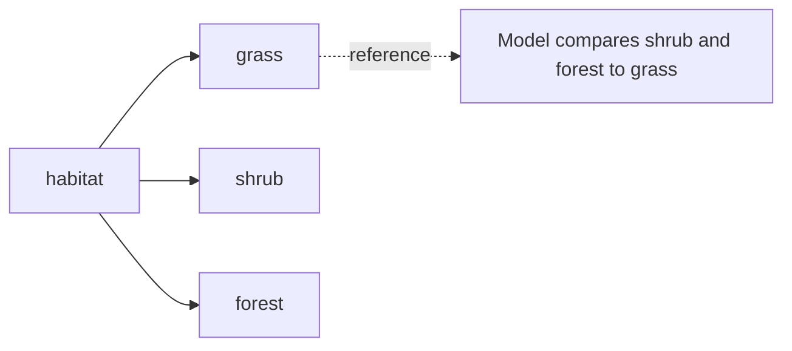

# Categorical Variable

Sort your laundry into piles: whites, colours, darks. The piles have names, not sizes; "darks" is not twice "whites". You can count how many items are in each pile, but you cannot add or average the pile names. A **categorical variable** is like that: it records which group something belongs to, using names rather than amounts. Habitat type, observer, species and treatment are all categorical. R calls a categorical variable a *factor*, and each possible group is a *level*, so grassland is a level of the factor habitat. When the categories have a natural order but no fixed spacing, such as small, medium and large, the variable is a special case called an [[Ordinal Variable]].

Here is the trap they set. Habitat at five plots is grass, forest, grass, shrub, grass. Counting is fine: grass 3, forest 1, shrub 1. But suppose someone codes 1 = grass, 2 = shrub, 3 = forest and averages the codes: (1 + 3 + 1 + 2 + 1) / 5 = 1.6. "Habitat 1.6" means nothing. Recode forest as 2 and shrub as 3 and the "average" changes, even though no plot changed. That is the test of a categorical variable: if relabelling changes the arithmetic, the arithmetic was meaningless. Numbers used as labels, such as plot IDs or habitat codes, are still labels, and this is why categorical data are not the same as counts, which have real size and order ([[Discrete Data]]).

Telling R that a column is a factor matters because otherwise R will happily fit a slope across the codes, as if forest were "three times" grassland. Marked as a factor, a categorical [[Predictor Variable|predictor]] becomes a set of comparisons in a model: one level is the *[[Reference Level|reference level]]*, and each other level gets its own estimated difference from it ([[Dummy Coding]]). By default R orders levels alphabetically, so "forest" would be the reference here unless you set it. Categorical predictors appear in every lab, and categorical grouping variables such as site are the heart of [[Mixed Effects Model|mixed models]] ([[Grouping Variable|Grouping Factor]]). Underneath it all, a categorical variable is one kind of [[Variable]], the kind measured with names.


*What to look at:* levels are separate boxes, not points on a line.

```r
habitat <- factor(c("grass", "forest", "grass", "shrub", "grass"))
levels(habitat)     # "forest" "grass" "shrub" (alphabetical by default)
table(habitat)      # counts per level: fine
codes <- c(1, 3, 1, 2, 1)
mean(codes)         # 1.6: arithmetic on labels is meaningless
```

## Connections
- **Builds on:** [[Variable]]
- **Leads to:** [[Dummy Coding]], [[Grouping Variable|Grouping Factor]], [[Interaction Term|Interaction]], [[Predictor Variable]], [[Reference Level]], [[Mixed Effects Model]]
- **Part of:** [[MOC 01 - Basics from Zero|MOC - Basics from Zero]], molecular note [[Continuous vs Discrete Data]]
- **Go deeper:** [[Data Frame|Data Frames and Tibbles]]

## Flashcards

You code habitat as 1, 2, 3. What must you tell R and why?
??
That it is a factor (categorical); otherwise R fits a meaningless slope across the codes.
++++

What is a factor level?
??
One of the named groups a categorical variable can take (e.g., grassland is a level of habitat).
++++
