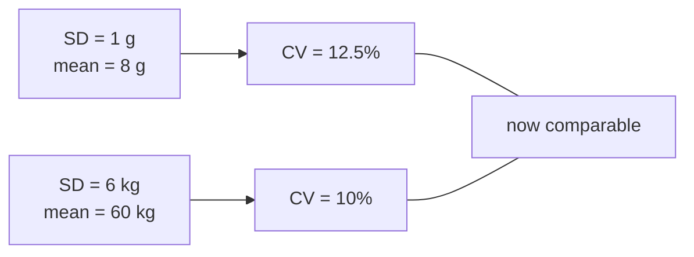

# Coefficient of Variation

A 1 kg error is huge on a bag of flour and nothing on an elephant. The **coefficient of variation** (CV) captures that: it is the [[Standard Deviation]] divided by the [[Mean]], so it expresses spread as a fraction of the typical size, often written as a percentage. Because grams divided by grams cancel, the CV is *unitless*, and that is the whole point: it lets you compare the variability of things measured on very different scales or in different units.

An example. Shrews have a mean mass of 8 g with an SD of 1 g, so their CV is 1 / 8 = 0.125, or 12.5%. Deer have a mean of 60 kg with an SD of 6 kg, a CV of 6 / 60 = 0.10, or 10%. In grams the deer's SD is 6,000 times larger, yet relative to their size deer are *less* variable than shrews. Raw SDs cannot be set side by side here because each carries the units and the sheer size of what was measured; in nature, bigger things vary more in absolute terms. Dividing by the mean removes both. Some distributions, such as the [[Gamma Distribution]] and the [[Lognormal Distribution]], even have a constant CV built in: their spread grows in step with their mean.

The same idea measures the [[Precision]] of an estimate: divide its standard error by the estimate. A population estimate of 200 with an SE of 40 has a CV of 20%, a common target in wildlife surveys, and Powell and Gale report the precision of abundance estimates this way ([[Powell and Gale 2015 Ch2]]). The CV has limits. It only makes sense for positive quantities measured from a true zero, such as mass, length, counts and density. It fails when the mean is near zero (the ratio explodes) or when the zero point is arbitrary: temperature in degrees Celsius can be zero or negative without meaning "no temperature", so dividing by its mean is meaningless.


*What to look at:* dividing by the mean removes the units and the scale.

```r
cv <- function(x) sd(x) / mean(x)
set.seed(3)
shrew <- rnorm(50, 8, 1); deer <- rnorm(50, 60000, 6000)   # both in grams
c(sd(shrew), sd(deer))    # wildly different
c(cv(shrew), cv(deer))    # about 0.11 and 0.08
```
The CVs are comparable even though the SDs differ by thousands.

## Connections
- **Builds on:** [[Standard Deviation]], [[Mean]]
- **Leads to:** [[Precision]], [[Gamma Distribution]], [[Lognormal Distribution]]
- **Part of:** [[MOC 01 - Basics from Zero|MOC - Basics from Zero]]

## Flashcards

What is the coefficient of variation?
??
The standard deviation divided by the mean, a unitless measure of relative spread.
++++

Why use CV instead of SD to compare variability?
??
SD depends on the units and size of what was measured. CV removes both.
++++

When is CV not meaningful?
??
When the mean is near zero or the scale has an arbitrary zero, such as degrees Celsius.
++++
