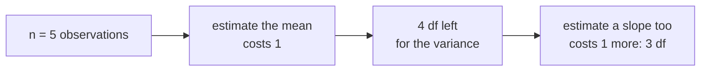

# Degrees of Freedom

Five friends split a 100 dollar bill. The first four can pay whatever they like, but the fifth has no choice: they pay whatever is left. Five payments, only four of them free. **Degrees of freedom** (df) count the free pieces like that: the number of independent pieces of information left to estimate variability after the data have already been used to estimate other things. In statistics the "bill" is not a known total but an estimate, such as the mean, computed from the same data, and every such estimate imposes a *constraint*, a rule the numbers must obey.

Take the values 2, 3, 3, 5 and 7, with mean 4. The [[Deviation|deviations]] from the mean are −2, −1, −1, 1 and 3, and deviations from a mean always sum to zero. So if you know any four, the fifth is forced: −(−2 − 1 − 1 + 1) = 3. Only 4 deviations are free, so df = n − 1 = 4. The variance divides the [[Sum of Squares]] by this count: 16 / 4 = 4. Dividing by 5 would give 3.2, too small, because the [[Mean|sample mean]] sits closer to its own data than the true mean does, so squared deviations from it run slightly small on average; dividing by n − 1 corrects that exactly ([[Variance]]). Each extra [[Parameter]] you estimate costs one more degree of freedom: a regression with an intercept and a slope leaves n − 2, and with p coefficients, n − p. These *residual df* appear in every `summary(lm)` and in the [[Residual Standard Error]].

Think of the data as a fixed budget of information. Every number you estimate spends some of it, leaving less to judge how noisy things are, and degrees of freedom keep the accounts. With few df the variance estimate is shaky, which is why the [[Student t Distribution]] has fatter tails at low df and why [[F-test]]s need df too. Ignore the accounting and you claim more certainty than the data hold, the same mistake made when dependent observations are counted as independent ([[Pseudoreplication]]). Two clarifications: df is not the [[Sample Size|sample size]], it is the sample size minus what estimation used up; and df need not be whole numbers, since smoothers and [[Mixed Effects Model|mixed models]] have fractional [[Effective Degrees of Freedom]]. For mixed models the right df is unclear, which is why lme4 prints no p-values ([[p-values in Mixed Models]]).


*What to look at:* every estimated parameter is paid for out of the same budget.

```r
x <- c(2, 3, 3, 5, 7)
sum((x - mean(x))^2) / (length(x) - 1)   # 4
var(x)                                    # 4: R divides by n - 1
set.seed(1); d <- data.frame(x = 1:10, y = rnorm(10))
df.residual(lm(y ~ x, d))                 # 8 = 10 - 2
# why n - 1: dividing by n underestimates on average
mean(replicate(20000, {s <- rnorm(5, 0, 2); c(sum((s - mean(s))^2) / 5)}))   # near 3.2, not 4
```
The true variance is 4. Dividing by n gives about 3.2 on average, dividing by n − 1 gives 4.

## Connections
- **Builds on:** [[Sum of Squares]], [[Variance]], [[Parameter]], [[Deviation]], [[Mean]], [[Sample Size]]
- **Leads to:** [[Residual Standard Error]], [[Student t Distribution]], [[F-test]], [[Number of Parameters]], [[Mixed Effects Model]]
- **See also:** [[Zuur et al. 2009 Ch2]]
- **Part of:** [[MOC 01 - Basics from Zero|MOC - Basics from Zero]], molecular note [[Why the variance divides by n minus 1]]

## Flashcards

What are degrees of freedom?
??
The number of independent pieces of information left for estimating variability after other quantities have been estimated.
++++

Why does the sample variance divide by n − 1?
??
Estimating the mean uses up one piece of information, and deviations from the sample mean are slightly too small on average.
++++

What are the residual degrees of freedom of a regression?
??
n minus the number of estimated coefficients.
++++
