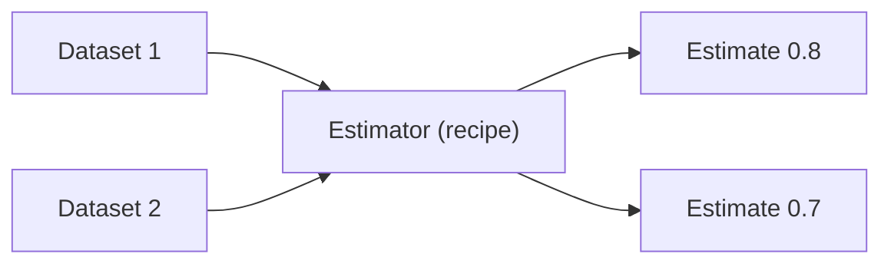

# Estimator

**In one line:** an estimator is the recipe (a formula or procedure) that turns data into an estimate, such as "add up the values and divide by how many there are".

> [!info] Before this, it helps to know
> [[Parameter]] (what is being guessed) · [[Estimate]] (the number the recipe produces)

## The everyday picture
At the sweet-jar stall, one person's method is "count one layer, then multiply by the number of layers". That *method* is an estimator. Apply it on Monday and you get 480; apply it on Tuesday from a different side and you get 530. The method stays the same; its output changes. Because the method is written down, you can judge it before using it: does it tend to guess too high? Does it vary a lot?

*Where the picture stops working:* a sweet-jar method is judged by opening jars. A statistical estimator is judged with maths or with simulation, because the truth is never revealed.

## Words you'll need
- **Estimator:** a recipe for turning data into a guess about a parameter.
- **Estimate:** one number produced by applying the recipe to one dataset ([[Estimate]]).
- **Unbiased estimator:** one that is right on average over many samples ([[Bias]]).
- **Sampling distribution:** the spread of estimates the recipe would give over many samples ([[Standard Error]]).

## A tiny example
Three recipes for the same parameter, the true survival rate:
- **Recipe A:** "number alive ÷ number tagged". With 8 of 10 alive, A gives **0.8**.
- **Recipe B:** "always say 0.5". It gives **0.5** whatever the data. It never wobbles, but it's useless (badly biased).
- **Recipe C:** "number alive ÷ (number tagged + 1)". With 8 of 10 alive, C gives 8/11 = **0.73**. Slightly low on average, but less jumpy when n is tiny.

Same data, three estimators, three estimates. Choosing the recipe is a real decision.

## Start from zero
1. **To guess a parameter, you need a rule for using the data.** That rule is the estimator.
2. **The sample mean is an estimator:** x̄ = (sum of values) / n ([[Mean]]). So is Powell and Gale's survival estimator, Ŝ = n alive / n tagged ([[Powell and Gale 2015 Ch1]], p. 6).
3. **Apply the recipe to one dataset and you get one estimate.**
4. **You can judge a recipe without knowing the truth.** *How:* imagine (or simulate) applying it to thousands of samples, and look at whether its answers centre on the truth ([[Bias]]) and how tightly they cluster ([[Precision]]).
5. **Most fitting methods are estimators.** Least squares ([[Least Squares]]) and maximum likelihood ([[Maximum Likelihood Estimation]]) are general-purpose recipes.

## See it

*What to look at:* one recipe, many datasets, many estimates.

## Why it is this way
You can't grade a single guess when the truth is hidden, but you *can* grade a recipe by how it behaves over many imagined samples. That's why statisticians talk about estimators: it's the only level at which "good" and "bad" can be judged.

## In R
```r
estimator_A <- function(alive) mean(alive)                         # alive / tagged
estimator_C <- function(alive) sum(alive) / (length(alive) + 1)
set.seed(2)
sims <- replicate(5000, rbinom(10, 1, 0.8), simplify = FALSE)     # 5000 studies of 10 elk
mean(sapply(sims, estimator_A))   # about 0.80: unbiased
mean(sapply(sims, estimator_C))   # about 0.73: biased low
```

## In the course
Powell and Gale define an estimator as the formula that produces an estimate ([[Powell and Gale 2015 Ch2]], p. 16), and their whole primer is a catalogue of estimators for animal populations.

## Common confusions
- **Estimator vs estimate.** The recipe vs the number it produced.
- **"An estimator that never varies is precise, so good."** Recipe B never varies and is useless. Precision without lack of bias isn't enough.

## Explain it back
- Use the sweet-jar method to explain what an estimator is.
- How can you judge an estimator if you never learn the truth?
- In the tiny example, why is recipe B bad even though it never wobbles?

*Pass test:* you can name the estimator behind any estimate you report.

## Connections
- **Builds on:** [[Parameter]], [[Estimate]]
- **Leads to:** [[Bias]], [[Precision]], [[Least Squares]], [[Maximum Likelihood Estimation]]
- **Part of:** [[MOC 01 - Basics from Zero|MOC - Basics from Zero]], molecular note [[Parameter vs Estimate]]
- **Go deeper:** [[Powell and Gale 2015 Ch2]]

## Flashcards

What is an estimator?
??
The recipe or formula that turns data into an estimate of a parameter.
++++

How do you judge an estimator when the truth is never known?
??
By how it would behave over many samples (simulated or worked out with maths): is it centred on the truth (bias) and how tightly do its estimates cluster (precision)?
++++
