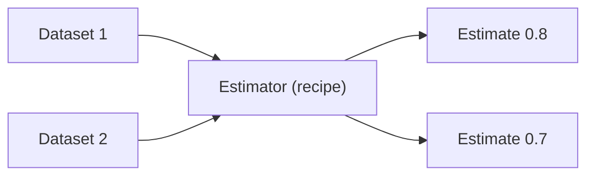

# Estimator

At the sweet-jar stall, one person's method is "count one layer, then multiply by the number of layers". That *method* is an **estimator**: the recipe, a formula or procedure, that turns data into an [[Estimate]] of a [[Parameter]]. Apply the method on Monday and you get 480; apply it on Tuesday from a different side and you get 530. The method stays the same while its output changes. The sample [[Mean]], "add the values and divide by how many there are", is an estimator, and so is Powell and Gale's survival estimator, number alive divided by number tagged ([[Powell and Gale 2015 Ch1]]).

Same data, different recipes, different answers. Suppose 8 of 10 tagged animals are alive. Recipe A, "alive ÷ tagged", gives 0.8. Recipe B, "always say 0.5", gives 0.5 whatever the data; it never wobbles, but it is useless. Recipe C, "alive ÷ (tagged + 1)", gives 8 / 11 = 0.73; it runs slightly low on average but is less jumpy when samples are tiny. Choosing the recipe is a real decision, and you can grade one without ever learning the truth: imagine, or simulate, applying it to thousands of samples. The spread of answers it would produce is its *[[Sampling Distribution|sampling distribution]]*. If those answers centre on the truth the estimator is *unbiased* ([[Bias]]); how tightly they cluster is its [[Precision]], summarised by the [[Standard Error]]. Simulating 5,000 studies of 10 animals with true survival 0.8, recipe A averages 0.80 and recipe C about 0.73.

This is why statisticians talk about estimators and not just estimates. A single guess cannot be graded when the truth is hidden, but a recipe can be graded by how it behaves over many imagined samples, which is the only level at which "good" and "bad" can be judged. Recipe B shows that precision alone is not enough: an estimator that never varies but is always wrong is worthless. Most fitting methods are general-purpose estimators: [[Least Squares]] and [[Maximum Likelihood Estimation]] are recipes that work for whole families of models. Powell and Gale define an estimator as the formula that produces an estimate ([[Powell and Gale 2015 Ch2]]), and their primer is largely a catalogue of estimators for animal populations. Remember the pair: the estimator is the recipe, the estimate is the number it produced.


*What to look at:* one recipe, many datasets, many estimates.

```r
estimator_A <- function(alive) mean(alive)                         # alive / tagged
estimator_C <- function(alive) sum(alive) / (length(alive) + 1)
set.seed(2)
sims <- replicate(5000, rbinom(10, 1, 0.8), simplify = FALSE)     # 5000 studies of 10 elk
mean(sapply(sims, estimator_A))   # about 0.80: unbiased
mean(sapply(sims, estimator_C))   # about 0.73: biased low
```

## Connections
- **Builds on:** [[Parameter]], [[Estimate]]
- **Leads to:** [[Bias]], [[Precision]], [[Least Squares]], [[Maximum Likelihood Estimation]], [[Sampling Distribution]]
- **Part of:** [[MOC 01 - Basics from Zero|MOC - Basics from Zero]], molecular note [[Parameter vs Estimate]]
- **Go deeper:** [[Powell and Gale 2015 Ch2]]

## Flashcards

What is an estimator?
??
The recipe or formula that turns data into an estimate of a parameter.
++++

How do you judge an estimator when the truth is never known?
??
By how it would behave over many samples (simulated or worked out with maths): is it centred on the truth (bias) and how tightly do its estimates cluster (precision)?
++++
