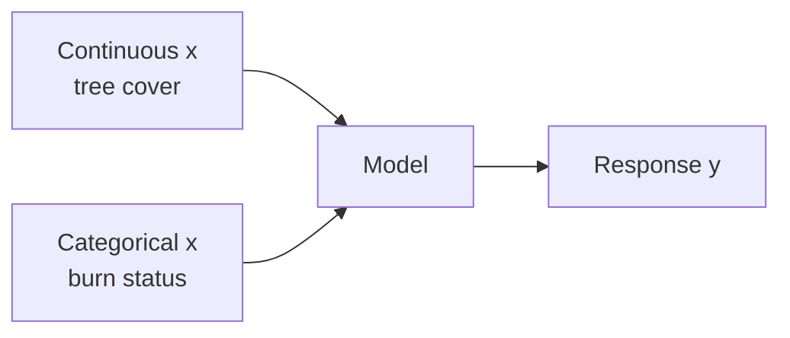

# Explanatory Variable

Think of a sound mixing desk. The sound coming out is the result, and each dial (bass, treble, volume) is something that changes it. A model tries to learn what each dial does. An **explanatory variable** is one of those dials: something you measure because it might explain or predict the [[Response Variable]]. It is usually written **x**, and it also goes by the names *predictor*, *covariate* (often meaning a continuous one) and *independent variable*. It can be a number, such as tree cover in percent, or a group label, such as burned versus unburned. A group label is called a *factor* ([[Categorical Variable]]).

Here is how it works in practice. Suppose bird richness on some plots might depend on tree cover and on whether the plot burned. The model formula is `birds ~ tree + burn`: two dials, one sound. The model gives each explanatory variable a [[Regression Coefficient]], the number that says how much the response changes per unit of that variable. For tree cover it is the change in species per extra percent of cover; for burning it is the difference between burned and unburned plots, which R handles by turning the factor into 0/1 columns ([[Dummy Coding]]). Units matter: a slope per metre is 1,000 times smaller than the same slope per kilometre, which is one reason analysts often [[Standardizing|standardize]] predictors. Ordinary models also treat the x values as known exactly, ignoring any measurement error in them ([[Fixed X Assumption]]).

Two warnings. First, "independent variable" is a misleading name. It does not mean the predictors are independent of each other; in field data they usually move together (more trees, less grass, more shade). An engineer can turn one dial at a time, but nature turns several at once, and that makes their separate effects hard to untangle ([[Collinearity]]). Second, more predictors are not automatically better. Each one costs data and raises the risk of fitting noise ([[Overfitting]]). That is why the course starts each analysis from hypotheses that name the predictors in advance instead of trying every column you happen to have ([[Data Dredging]]), and why Guthery and Bingham warn against reading coefficients carelessly ([[Guthery and Bingham 2007]]).


*What to look at:* predictors can be numbers or groups, and both feed the same model.

```r
d <- data.frame(tree = c(10, 20, 30, 40, 50, 15, 35),
                burn = c("yes", "yes", "no", "no", "no", "yes", "no"),
                birds = c(9, 8, 6, 5, 3, 9, 5))
m <- lm(birds ~ tree + burn, data = d)   # two explanatory variables
coef(m)
```
One coefficient for tree cover, one for being burned compared with unburned.

## Connections
- **Builds on:** [[Response Variable]], [[Variable]]
- **Leads to:** [[Regression Coefficient]], [[Collinearity]], [[Dummy Coding]]
- **Part of:** [[MOC 01 - Basics from Zero|MOC - Basics from Zero]]

## Flashcards

What is an explanatory variable?
??
A measured variable used to explain or predict the response, on the right of ~.
++++

Give three other names for an explanatory variable.
??
Predictor, covariate, independent variable.
++++

Why is "independent variable" misleading?
??
Predictors are often correlated with one another.
++++
