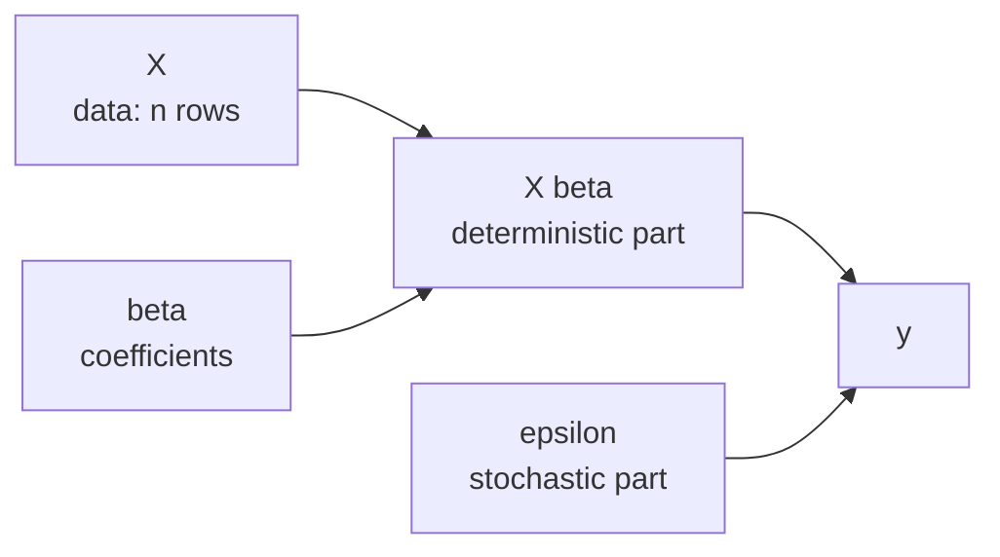

# Matrix Notation for Models

Think of a mail merge: one letter template plus a table of names produces a hundred personalised letters. **Matrix notation** writes an entire regression the same way, as the single line y = Xβ + ε. Here **y** is the vector of n responses; X is the *model matrix* (also called the design matrix), with one row per observation and one column per [[Regression Coefficient|coefficient]], the first column all ones for the intercept; β (beta) is the vector of coefficients, the template; and ε (epsilon) is the vector of n errors, the leftovers the template cannot explain ([[Error Term]]). Xβ is the stack of predictions. A mail merge is exact; a model adds ε.

Build it from one row. The [[Linear Regression]] for observation i is yᵢ = β₀ + β₁xᵢ + εᵢ, which is the dot product of (1, xᵢ) with (β₀, β₁), plus an error. Stack all n observations and the rows (1, xᵢ) form X ([[Matrix]], [[Subscripts and Indexing]]). With numbers: three plots have tree cover 2, 5 and 9 and [[Species Richness|richness]] 11.2, 12.1 and 14.8. With β = (10, 0.5), Xβ = (11, 12.5, 14.5), so ε = y − Xβ = (0.2, −0.4, 0.3), and (11.2, 12.1, 14.8) = (11, 12.5, 14.5) + (0.2, −0.4, 0.3): one line, three equations. Least squares has a one-line answer in this notation, β̂ = (X′X)⁻¹X′y, which for these data gives an intercept of 9.91 and a slope of 0.523, exactly what `lm()` reports ([[Least Squares]]).

The point of the notation is structure. Writing a model row by row with subscripts becomes unreadable beyond two [[Predictor Variable|predictors]], but y = Xβ + ε shows the whole idea at a glance: data times unknowns, the deterministic part, plus noise, the [[Stochastic Component|stochastic part]]. Adding a predictor only adds a column to X and an element to β; the equation does not change shape, which is why one theory covers all [[Linear Model|linear models]]. [[Mixed Effects Model|Mixed models]] add a second matrix, y = Xβ + Zb + ε, where Z says which group each observation belongs to and b holds the group effects ([[Linear Mixed Model]]). Two clarifications: X is not the raw data but the data after R has added the intercept column and turned factors into 0/1 columns ([[Model Matrix]], [[Dummy Coding]]); and β here is the whole vector of coefficients, not one number. Being able to read this form unlocks the equations in Zuur's book and in Harrison and colleagues ([[Zuur et al. 2009 Ch5]], [[Harrison et al. 2018]]).


*What to look at:* the deterministic and stochastic parts of the model are the two things added together.

```r
tree <- c(2, 5, 9); rich <- c(11.2, 12.1, 14.8)
X <- model.matrix(~ tree); X                 # column of 1s and the predictor
beta_hat <- solve(t(X) %*% X) %*% t(X) %*% rich
beta_hat                                      # intercept 9.91, slope 0.523
coef(lm(rich ~ tree))                         # identical
```
`lm()` is doing this matrix arithmetic behind the scenes.

## Connections
- **Builds on:** [[Matrix]], [[Linear Regression]]
- **Leads to:** [[Model Matrix]], [[Least Squares]], [[Linear Mixed Model]], [[Regression Coefficient]], [[Species Richness]], [[Predictor Variable]], [[Stochastic Component]], [[Linear Model]], [[Mixed Effects Model]]
- **Part of:** [[MOC 01 - Basics from Zero|MOC - Basics from Zero]]

## Flashcards

What do the symbols in y = Xβ + ε stand for?
??
y: responses. X: model matrix of predictors. β: coefficients. ε: errors.
++++

What is in the first column of X in a model with an intercept?
??
All ones, so the intercept is added to every observation.
++++

How does the matrix form change when a predictor is added?
??
X gains a column and β gains an element. The equation stays the same.
++++
