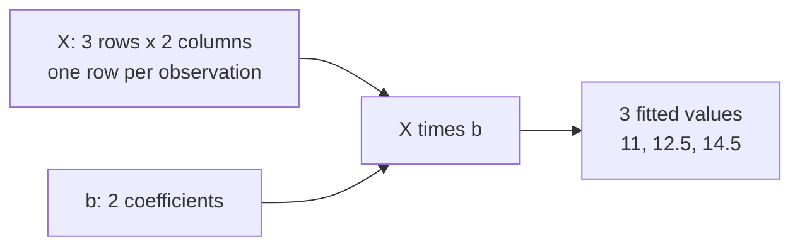

# Matrix

**In one line:** a matrix is a rectangular table of numbers with rows and columns, treated as one object.

> [!info] Before this, it helps to know
> [[Vector]] (one column of numbers) · [[Observation]] (a row of data)

## The everyday picture
A spreadsheet. Rows are plots, columns are measurements. A matrix is a spreadsheet stripped of its headings, leaving only the grid of numbers, so that maths can be done on the whole grid at once.

*Where the picture stops working:* a spreadsheet can hold words. A matrix holds numbers only.

## Words you'll need
- **Dimensions:** rows × columns, such as 3 × 2.
- **Element xᵢⱼ:** the entry in row i, column j.
- **Transpose:** flipping rows and columns, written X′ or Xᵀ.
- **Matrix multiplication:** dot products of rows of the first with columns of the second.

## A tiny example
X has rows (1, 2), (1, 5), (1, 9): a column of ones and a column of predictor values. **b** = (10, 0.5).
- X**b** = row by row dot products:
- Row 1: 1 × 10 + 2 × 0.5 = **11**.
- Row 2: 10 + 2.5 = **12.5**.
- Row 3: 10 + 4.5 = **14.5**.
One multiplication produced the prediction for every observation.

## Start from zero
1. **Put several vectors of equal length side by side.** That is a matrix.
2. **Name its size rows first.** 3 × 2 means 3 rows, 2 columns.
3. **Multiply a matrix by a vector with dot products.** Each row gives one number.
4. **Sizes must match.** *Why:* each dot product needs the same number of entries on both sides, so the columns of the first must equal the rows of the second.
5. **Special matrices describe relationships.** A covariance matrix holds the variances on its diagonal and covariances off it ([[Covariance]]).

## See it

*What to look at:* rows are observations, columns are predictors, and the product is the fitted values.

## Why it is this way
A model applies the same sum-of-products to every row of data. Matrix multiplication is that operation done to all rows at once. It keeps formulas for 2 predictors and 200 predictors looking identical, and it is how R actually computes every fit.

## In R
```r
X <- cbind(1, c(2, 5, 9)); X     # a 3 x 2 matrix
dim(X)                            # 3 2
b <- c(10, 0.5)
X %*% b                           # 11.0 12.5 14.5
t(X)                              # transpose: 2 x 3
```
`%*%` is matrix multiplication. Plain `*` would multiply element by element.

## In the course
Zuur and colleagues write mixed models with matrices X and Z ([[Zuur et al. 2009 Ch5]]). The matrix R builds from a formula is the [[Model Matrix]].

## Common confusions
- **"Rows and columns can be swapped freely."** X**b** works only when columns of X match the length of **b**.
- **"A data frame is a matrix."** A data frame can mix types. A matrix is all one type ([[Matrices in R]]).

## Explain it back
- What are the dimensions of a matrix with 50 plots and 4 predictors plus an intercept column?
- Compute the product of rows (1, 3), (1, 4) with (2, 1).

*Pass test:* you can multiply a small matrix by a vector by hand.

## Connections
- **Builds on:** [[Vector]]
- **Leads to:** [[Matrix Notation for Models]], [[Model Matrix]], [[Multivariate Normal Distribution]]
- **Part of:** [[MOC 01 - Basics from Zero|MOC - Basics from Zero]]

## Flashcards

What is a matrix?
??
A rectangular table of numbers with rows and columns, treated as one object.
++++

How do you multiply a matrix by a vector?
??
Take the dot product of each row of the matrix with the vector.
++++

What does a covariance matrix hold?
??
Variances on the diagonal and covariances between pairs of variables off the diagonal.
++++
