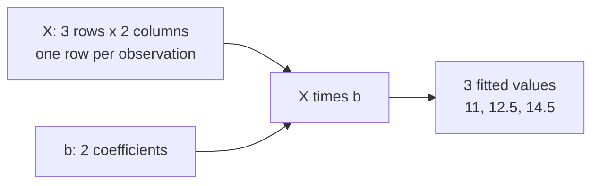

# Matrix

Picture a spreadsheet where rows are plots and columns are measurements. Strip away the headings and keep only the grid of numbers, and you have a **matrix**: a rectangular table of numbers treated as one object, so that maths can be done on the whole grid at once. Its size, or *dimensions*, are given rows first: a 3 × 2 matrix has 3 rows and 2 columns. The entry in row i and column j is written xᵢⱼ. Flipping [[Data Table Rows and Columns|rows and columns]] is the *transpose*, written X′ or Xᵀ. A matrix is several [[Vector]]s of equal length side by side, and, unlike a spreadsheet or a [[Data Frame|data frame]], it holds one type of value only ([[Matrices in R]]).

The operation that makes matrices useful is multiplication by a vector: take the dot product of each row with the vector. Let X have rows (1, 2), (1, 5) and (1, 9), a column of ones and a column of [[Predictor Variable|predictor]] values, and let **b** = (10, 0.5) be an intercept and a slope. Row 1 gives 1 × 10 + 2 × 0.5 = 11. Row 2 gives 10 + 2.5 = 12.5. Row 3 gives 10 + 4.5 = 14.5. One multiplication produced the prediction for every observation. The sizes must match: each dot product needs the same number of entries on both sides, so the number of columns of X must equal the length of **b**. You cannot swap rows and columns freely.

A model applies the same sum-of-products to every row of data, and matrix multiplication is that operation done to all rows at once. It keeps a formula for 2 predictors and one for 200 predictors looking identical, and it is how R actually computes every fit; the matrix R builds from a model formula is the [[Model Matrix]], and the whole regression becomes y = Xβ + ε ([[Matrix Notation for Models]]). Special matrices describe relationships too: a [[Variance-Covariance Matrix|covariance matrix]] holds each variable's variance on its diagonal and the [[Covariance]] between pairs off it, which is the heart of the [[Multivariate Normal Distribution]]. Zuur and colleagues write [[Mixed Effects Model|mixed models]] with two such matrices, X and Z ([[Zuur et al. 2009 Ch5]]). In each row of a data matrix sits one [[Observation]].


*What to look at:* rows are observations, columns are predictors, and the product is the [[Fitted Value|fitted values]].

```r
X <- cbind(1, c(2, 5, 9)); X     # a 3 x 2 matrix
dim(X)                            # 3 2
b <- c(10, 0.5)
X %*% b                           # 11.0 12.5 14.5
t(X)                              # transpose: 2 x 3
```
`%*%` is matrix multiplication. Plain `*` would multiply element by element.

## Connections
- **Builds on:** [[Vector]], [[Data Table Rows and Columns]]
- **Leads to:** [[Matrix Notation for Models]], [[Model Matrix]], [[Multivariate Normal Distribution]], [[Data Frame]], [[Predictor Variable]], [[Variance-Covariance Matrix]], [[Mixed Effects Model]], [[Fitted Value]]
- **Part of:** [[MOC 01 - Basics from Zero|MOC - Basics from Zero]]

## Flashcards

What is a matrix?
??
A rectangular table of numbers with rows and columns, treated as one object.
++++

How do you multiply a matrix by a vector?
??
Take the dot product of each row of the matrix with the vector.
++++

What does a covariance matrix hold?
??
Variances on the diagonal and covariances between pairs of variables off the diagonal.
++++
