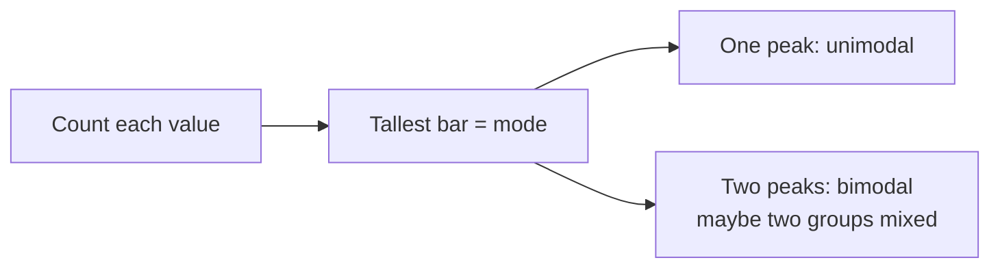

# Mode

Ask a shoe shop which size to stock most. The shop does not care about the average size (nobody wears size 8.37); it wants the most popular one. That is the **mode**: the value that occurs most often. How often a value occurs is its *frequency*, so the mode is the value with the highest frequency, the tallest bar in a [[Histogram]]. Clutch sizes of 9 nests read 3, 4, 4, 4, 5, 5, 6, 4, 3. The value 4 appears four times, more than any other, so the mode is 4 eggs.

For continuous measurements such as body mass, no two values repeat exactly, so the mode becomes the peak of a smoothed curve: the place where values are most densely packed. A distribution can have more than one peak. One peak is *unimodal*; two peaks is *bimodal*, and that is a clue worth chasing, because it often means two different groups are mixed together, such as males and females in a histogram of body mass ([[Mixture Distribution]]). Some datasets have no mode that stands out at all.

The mean and the [[Median]] describe the centre; the mode describes the single most probable outcome, which is what you want when the question is "what will I most likely see?". It is also the only centre that works for unordered categories: you cannot average species names, but you can say which species is commonest. The idea reaches far into estimation: a maximum likelihood estimate is the mode of the [[Likelihood Function|likelihood curve]] ([[Maximum Likelihood Estimation]]), and Hobbs and Hooten note that a posterior can be summarised by its mean, median or mode ([[Hobbs and Hooten 2015 Ch8]]). One R trap: the function `mode()` does something unrelated (it reports how R stores the data, such as "numeric"), so find a mode with `table()` and `which.max()`.


*What to look at:* a second peak is a clue worth chasing.

```r
clutch <- c(3, 4, 4, 4, 5, 5, 6, 4, 3)
tab <- table(clutch); tab
names(tab)[which.max(tab)]         # "4": R has no built-in mode function
# continuous data: peak of the density curve
set.seed(1); mass <- rnorm(200, 20, 3)
d <- density(mass); d$x[which.max(d$y)]   # near 20
```
R's `mode()` does something unrelated (it reports storage type), so use `table()`.

## Connections
- **Builds on:** [[Median]], [[Histogram]]
- **Leads to:** [[Mixture Distribution]], [[Maximum Likelihood Estimation]], [[Likelihood Function]]
- **Part of:** [[MOC 01 - Basics from Zero|MOC - Basics from Zero]], molecular note [[Mean, Median and Mode]]

## Flashcards

What is the mode?
??
The most frequent value, or the peak of a distribution.
++++

What can a bimodal histogram indicate?
??
Two different groups mixed together, such as males and females.
++++

Does R's mode() function return the statistical mode?
??
No. It returns the storage type. Use table() and which.max().
++++
