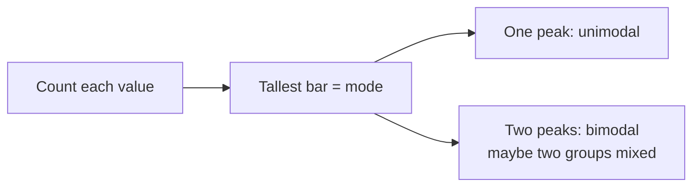

# Mode

**In one line:** the mode is the value that occurs most often, or the highest point of a distribution's curve.

> [!info] Before this, it helps to know
> [[Median]] (the middle value) · [[Histogram]] (bars showing how often values occur)

## The everyday picture
The most popular shoe size in a shop. The shop doesn't care about the average size (nobody wears 8.37). It wants to know which size to stock most. That is the mode.

*Where the picture stops working:* shoe sizes are a short list. For continuous measurements no two values repeat exactly, so the mode becomes the peak of a smoothed curve.

## Words you'll need
- **Frequency:** how many times a value occurs.
- **Unimodal:** having one peak.
- **Bimodal:** having two peaks, often a sign of two mixed groups.

## A tiny example
Clutch sizes of 9 nests: 3, 4, 4, 4, 5, 5, 6, 4, 3.
- Counts: 3 occurs 2 times, 4 occurs **4 times**, 5 occurs 2 times, 6 once.
- Mode = **4** eggs.

## Start from zero
1. **Count how often each value occurs.**
2. **The most frequent value is the mode.**
3. **For continuous data, find the peak.** *Why:* exact repeats are rare, so you look for where values are most densely packed.
4. **There can be more than one.** Two peaks in body size may mean males and females.
5. **In estimation, the mode is the "most likely" value.** The maximum likelihood estimate is the mode of the likelihood curve ([[Maximum Likelihood Estimation]]).

## See it

*What to look at:* a second peak is a clue worth chasing.

## Why it is this way
The mean and median describe the centre. The mode describes the most probable single outcome, which matters when you ask "what will I most likely see?". It is also the only summary that works for unordered categories: you can't average species names, but you can say which is commonest.

## In R
```r
clutch <- c(3, 4, 4, 4, 5, 5, 6, 4, 3)
tab <- table(clutch); tab
names(tab)[which.max(tab)]         # "4": R has no built-in mode function
# continuous data: peak of the density curve
set.seed(1); mass <- rnorm(200, 20, 3)
d <- density(mass); d$x[which.max(d$y)]   # near 20
```
R's `mode()` does something unrelated (it reports storage type), so use `table()`.

## In the course
Hobbs and Hooten summarise posteriors by mean, median or mode ([[Hobbs and Hooten 2015 Ch8]]). Histograms in the data exploration lab are checked for more than one mode ([[Course Website]]).

## Common confusions
- **"mode() in R gives the mode."** It gives the data type, such as "numeric".
- **"Every dataset has one mode."** It may have several, or none that stands out.

## Explain it back
- For which kind of variable is the mode the only sensible centre?
- What might two modes in a histogram of body mass mean?

*Pass test:* you can find a mode from a table and say what bimodality hints at.

## Connections
- **Builds on:** [[Median]], [[Histogram]]
- **Leads to:** [[Mixture Distribution]], [[Maximum Likelihood Estimation]]
- **Part of:** [[MOC 01 - Basics from Zero|MOC - Basics from Zero]], molecular note [[Mean, Median and Mode]]

## Flashcards

What is the mode?
??
The most frequent value, or the peak of a distribution.
++++

What can a bimodal histogram indicate?
??
Two different groups mixed together, such as males and females.
++++

Does R's mode() function return the statistical mode?
??
No. It returns the storage type. Use table() and which.max().
++++
