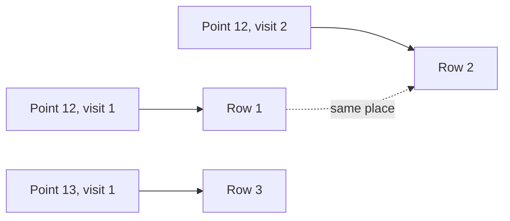

# Observation

**In one line:** an observation is one case on which you recorded your variables, such as one survey point on one visit. In a data table it is one row.

> [!info] Before this, it helps to know
> [[Variable]] (the things recorded on each observation)

## The everyday picture
In a school register, each **line** is one pupil: their age, height and favourite subject, all on one line. That line is an observation. A field notebook works the same way: each line is "everything I wrote down on this one occasion".

*Where the picture stops working:* in a register one line is always one pupil. In ecology one line might be one animal, one plot, one visit or one year. You must decide what a line stands for.

## Words you'll need
- **Row:** one line of a data table; one observation.
- **Sample size (n):** usually the number of rows, but see [[Sampling Unit]] for when it isn't.
- **Independent:** observations that don't share conditions that make them alike ([[Independence of Observations]]).
- **Pseudoreplication:** treating related rows as if they were independent ([[Pseudoreplication]]).

## A tiny example
Two survey points; point 12 visited twice, point 13 once.

| point | visit | wind | richness |
|---|---|---|---|
| 12 | 1 | 2 | 6 |
| 12 | 2 | 4 | 5 |
| 13 | 1 | 1 | 11 |

That's **3 observations** (rows). But only **2 places**. The two rows for point 12 share that point's habitat, soil and neighbours, so they aren't two fully separate pieces of evidence about birds in general.

Scale it up: 20 points × 3 visits = **60 observations**, still only **20 places**.

## Start from zero
1. **Each separate occasion of recording is one observation.** Point 12 on May 3 is one; point 12 on June 1 is another.
2. **Put each observation on its own row.** *Why:* then a row reads as "everything I saw on this occasion", and you can count your observations by counting rows.
3. **Decide what one row stands for before analysing.** *Why:* the model's sense of "how much evidence do I have" comes from counting rows.
4. **Check whether rows are independent.** Rows from the same place, animal or year are related. *Why it matters:* treating them as separate overstates the evidence ([[Pseudoreplication]]), which is what mixed models fix ([[Grouping Factor]]).

## See it

*What to look at:* three rows, but the dotted line warns that two of them share a place.

## Why it is this way
Statistics weighs evidence by counting it, and the row is what gets counted. That's why "what is one observation?" is the first question of any analysis: answer it wrongly and every standard error is wrong too.

## In R
```r
birds <- data.frame(point = c(12, 12, 13), visit = c(1, 2, 1),
                    wind = c(2, 4, 1), richness = c(6, 5, 11))
nrow(birds)                  # 3 observations
length(unique(birds$point))  # but only 2 places
```

## In the course
Every homework dataset has one observation per row ([[Homework]]), and the mixed models unit is built around rows that share a group ([[MOC 14 - Mixed Models|MOC - Mixed Models]]).

## Common confusions
- **"An observation is always one animal."** It's whatever one row stands for.
- **"More rows means more independent information."** Only if the rows are independent.

## Explain it back
- Using a school register, say what one observation is.
- Why are the two rows for point 12 not two separate pieces of evidence?
- 20 points visited 3 times: how many observations, and how many places?

*Pass test:* you can say in one sentence what one row stands for in any dataset.

## Connections
- **Builds on:** [[Variable]]
- **Leads to:** [[Sampling Unit]], [[Independence of Observations]], [[Pseudoreplication]], [[Tidy Data]]
- **Part of:** [[MOC 01 - Basics from Zero|MOC - Basics from Zero]], molecular note [[Variable and Observation]]
- **Go deeper:** [[Data Frame|Data Frames and Tibbles]]

## Flashcards

What is an observation in a data table?
??
One case on which the variables were recorded; one row.
++++

Why does it matter whether 60 rows are 60 independent observations?
??
If several rows are the same place or animal measured repeatedly, treating them as independent overstates the evidence (pseudoreplication).
++++
