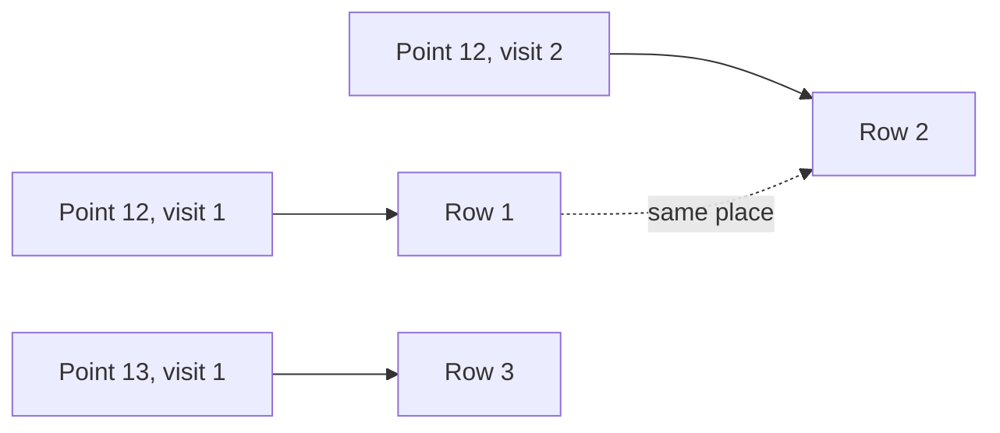

# Observation

In a school register each line is one pupil, with their age, height and favourite subject written side by side. A field notebook works the same way: each line is everything you wrote down on one occasion. An **observation** is that one case on which you recorded your variables, such as one survey point on one visit, and in a data table it is one *row* ([[Variable]]). In a register one line is always one pupil, but in ecology a row might stand for one animal, one plot, one visit or one year, so the first question of any analysis is: what does one row stand for?

That question matters because statistics weighs evidence by counting rows. Suppose point 12 is surveyed twice and point 13 once. The table has 3 rows, so 3 observations, but only 2 places. The two rows for point 12 share that point's habitat, soil and neighbouring birds, so they are not two fully separate pieces of evidence about birds in general. Scale it up: 20 points visited 3 times gives 60 observations but still only 20 places. Observations that do not share conditions making them alike are *independent* ([[Independence of Observations]]); rows from the same place, animal or year are usually not.

Treating related rows as if they were independent is called [[Pseudoreplication]], and it overstates your evidence, making every standard error too small and every result look surer than it is. So the *sample size* n is usually the number of rows, but not always; sometimes the number of independent units is what counts ([[Sampling Unit]]). The fix is not to throw away the repeated rows but to tell the model which rows belong together, which is what mixed models do with a [[Grouping Factor]] ([[MOC 14 - Mixed Models|MOC - Mixed Models]]). Every homework dataset is laid out with one observation per row ([[Homework]]), so knowing what a row is comes before anything else.


*What to look at:* three rows, but the dotted line warns that two of them share a place.

```r
birds <- data.frame(point = c(12, 12, 13), visit = c(1, 2, 1),
                    wind = c(2, 4, 1), richness = c(6, 5, 11))
nrow(birds)                  # 3 observations
length(unique(birds$point))  # but only 2 places
```

## Connections
- **Builds on:** [[Variable]]
- **Leads to:** [[Sampling Unit]], [[Independence of Observations]], [[Pseudoreplication]], [[Tidy Data]]
- **Part of:** [[MOC 01 - Basics from Zero|MOC - Basics from Zero]], molecular note [[Variable and Observation]]
- **Go deeper:** [[Data Frame|Data Frames and Tibbles]]

## Flashcards

What is an observation in a data table?
??
One case on which the variables were recorded; one row.
++++

Why does it matter whether 60 rows are 60 independent observations?
??
If several rows are the same place or animal measured repeatedly, treating them as independent overstates the evidence (pseudoreplication).
++++
