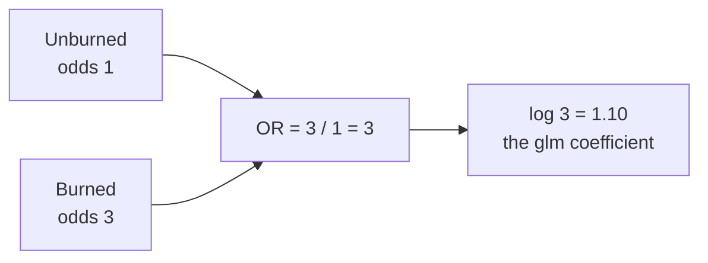

# Odds Ratio

**In one line:** an odds ratio compares two groups by dividing the odds in one by the odds in the other.

> [!info] Before this, it helps to know
> [[Odds]] (p over 1 − p) · [[Log Odds]] (the scale logistic models use)

## The everyday picture
Two fishing spots. At the pier you catch something on 1 trip in 2 (odds 1). At the reef, 3 trips in 4 (odds 3). The reef's odds are 3 times the pier's. That "3 times" is the odds ratio.

*Where the picture stops working:* "3 times the odds" is not "3 times as likely". The probability went from 0.5 to 0.75, only 1.5 times.

## Words you'll need
- **OR:** odds in group B divided by odds in group A.
- **OR = 1:** no difference.
- **exp(β):** e raised to a logistic regression coefficient, which is an odds ratio.

## A tiny example
Nest survival: unburned 10 of 20 survive, burned 15 of 20 survive.
- Odds unburned = 10 / 10 = **1**. Odds burned = 15 / 5 = **3**.
- Odds ratio = 3 / 1 = **3**.
- Log of the odds ratio = log(3) = **1.10**, exactly the coefficient a logistic regression gives for "burned".
- Risk ratio (ratio of probabilities) = 0.75 / 0.5 = 1.5. Different number, different meaning.

## Start from zero
1. **Compute the odds in each group.**
2. **Divide one by the other.**
3. **Read it against 1.** Above 1 means higher odds, below 1 lower.
4. **It is what logistic regression estimates.** *Why:* the model is additive in log odds, and a difference of logs is the log of a ratio. So exp(coefficient) = odds ratio.
5. **For a continuous predictor it is per unit.** exp(β) is the multiplication of the odds for each one-unit increase in x.
6. **Translate to probabilities for readers.** The same odds ratio means different probability changes at different baselines.

## See it

*What to look at:* the coefficient and the odds ratio are one number on two scales.

## Why it is this way
On the probability scale an effect can't be constant: adding 0.3 works from 0.5 but not from 0.9. On the odds scale a multiplication always works. So the odds ratio is the one effect measure that stays the same across baselines, which is why logistic models are built around it.

## In R
```r
d <- data.frame(burn = c("no", "yes"), alive = c(10, 15), dead = c(10, 5))
m <- glm(cbind(alive, dead) ~ burn, family = binomial, data = d)
coef(m)                 # burnyes = 1.10 (log odds ratio)
exp(coef(m)["burnyes"]) # 3, the odds ratio
predict(m, type = "response")   # 0.50 and 0.75, the probabilities
```
Exponentiate a logistic coefficient to get an odds ratio.

## In the course
Used whenever a binomial GLM or GLMM is interpreted, for example parasite presence in red deer ([[Course Website]]; [[Zuur et al. 2009 Ch10]]).

## Common confusions
- **"OR = 3 means three times as likely."** It means three times the odds. Probabilities change by less, unless the event is rare.
- **"OR below 1 is a negative effect size."** Odds ratios are never negative. 0.5 is as strong as 2, in the other direction.

## Explain it back
- Burned odds 3, unburned odds 1: what is the logistic coefficient?
- Why isn't an odds ratio of 3 the same as tripling the probability?

*Pass test:* you can compute an odds ratio from a 2 by 2 table and link it to a model coefficient.

## Connections
- **Builds on:** [[Odds]], [[Log Odds]]
- **Leads to:** [[Logistic Regression]], [[Interpreting Regression Coefficients]], [[Effect Size]]
- **Part of:** [[MOC 01 - Basics from Zero|MOC - Basics from Zero]], molecular note [[Probability, Odds and Log Odds]]

## Flashcards

What is an odds ratio?
??
The odds of an event in one group divided by the odds in another.
++++

How do you get an odds ratio from a logistic regression coefficient?
??
Exponentiate it: OR = exp(β).
++++

Why is an odds ratio of 3 not "three times as likely"?
??
It multiplies the odds, not the probability. From p = 0.5 it gives p = 0.75.
++++
