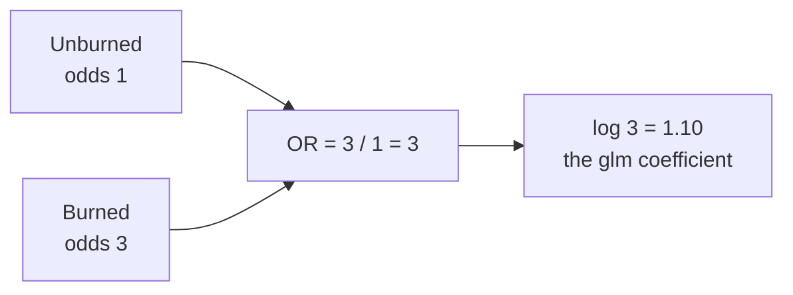

# Odds Ratio

Two fishing spots. At the pier you catch something on 1 trip in 2, odds of 1. At the reef you catch something on 3 trips in 4, odds of 3. The reef's odds are 3 times the pier's, and that "3 times" is the **odds ratio** (OR): the [[Odds]] of an event in one group divided by the odds in another. Read it against 1: an OR of 1 means no difference, above 1 means higher odds, below 1 lower odds. Odds ratios are never negative; 0.5 is as strong an effect as 2, just in the other direction.

Here is the key link to models. Nest survival: unburned plots, 10 of 20 nests survive; burned plots, 15 of 20. Odds unburned = 10 / 10 = 1, odds burned = 15 / 5 = 3, so the odds ratio is 3. Its logarithm, log(3) = 1.10, is exactly the coefficient a logistic regression gives for "burned". This is no coincidence: logistic regression is additive on the [[Log Odds]] scale, and a difference of two logs is the log of a ratio. So exponentiating a logistic coefficient, exp(β), gives an odds ratio. For a continuous predictor, exp(β) is how many times the odds are multiplied for each one-unit increase in x.

Be careful translating it. An OR of 3 does not mean "three times as likely". In the nest example the probability went from 0.50 to 0.75, only 1.5 times; that ratio of probabilities is a different quantity, the risk ratio. The two agree only when the event is rare. Why then build models around odds ratios? Because on the probability scale an effect cannot be constant: adding 0.3 works from 0.5 but not from 0.9. On the odds scale a multiplication always works, so the odds ratio is the effect measure that can stay the same across baselines. For readers, translate it back into probabilities at sensible baselines ([[Interpreting Regression Coefficients]], [[Effect Size]]). This is how every binomial GLM or GLMM in the course is read, for example parasite presence in red deer ([[Logistic Regression]], [[Zuur et al. 2009 Ch10]]).


*What to look at:* the coefficient and the odds ratio are one number on two scales.

```r
d <- data.frame(burn = c("no", "yes"), alive = c(10, 15), dead = c(10, 5))
m <- glm(cbind(alive, dead) ~ burn, family = binomial, data = d)
coef(m)                 # burnyes = 1.10 (log odds ratio)
exp(coef(m)["burnyes"]) # 3, the odds ratio
predict(m, type = "response")   # 0.50 and 0.75, the probabilities
```
Exponentiate a logistic coefficient to get an odds ratio.

## Connections
- **Builds on:** [[Odds]], [[Log Odds]]
- **Leads to:** [[Logistic Regression]], [[Interpreting Regression Coefficients]], [[Effect Size]]
- **Part of:** [[MOC 01 - Basics from Zero|MOC - Basics from Zero]], molecular note [[Probability, Odds and Log Odds]]

## Flashcards

What is an odds ratio?
??
The odds of an event in one group divided by the odds in another.
++++

How do you get an odds ratio from a logistic regression coefficient?
??
Exponentiate it: OR = exp(β).
++++

Why is an odds ratio of 3 not "three times as likely"?
??
It multiplies the odds, not the probability. From p = 0.5 it gives p = 0.75.
++++
