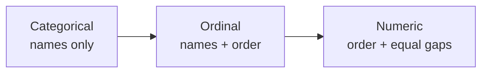

# Ordinal Variable

**In one line:** an ordinal variable sorts things into named categories that have a natural order, but the gaps between categories are not known numbers.

> [!info] Before this, it helps to know
> [[Categorical Variable]] (named groups) · [[Variable]] (a column of data)

## The everyday picture
Race results. First, second and third tell you the order of the runners, but not whether the winner was ahead by a nose or by a minute. The order is real, the spacing is unknown.

*Where the picture stops working:* in a race you could look up the times. For many ordinal scales, such as "low, medium, high" burn severity, no hidden number exists.

## Words you'll need
- **Category (level):** one of the possible named values.
- **Ordered:** the levels have a meaningful sequence.
- **Interval:** the size of the gap between two values.

## A tiny example
Burn severity on 6 plots: low, low, medium, high, medium, low.
- You can say high > medium > low.
- You cannot say high is "3 times" low, even if you code them 1, 2, 3.
- The middle value (median) is meaningful: sort them (low, low, low, medium, medium, high) and the middle is between low and medium.

## Start from zero
1. **Start with categories.** Names such as species have no order ([[Categorical Variable]]).
2. **Add an order.** Some categories rank naturally: age class (juvenile, yearling, adult), severity, cover class.
3. **But don't add arithmetic.** *Why:* nothing says the step from low to medium equals the step from medium to high, so means and differences are not trustworthy.
4. **Choose how to model it.** Treat it as unordered categories (safe), as a number (assumes equal steps) or with an ordinal model (keeps order only).

## See it

*What to look at:* ordinal data sit between names and numbers.

## Why it is this way
Measurement is often coarse in the field. An observer can reliably say "more cover" long before they can say "37% cover". Ordinal scales keep that honest. Treating them as numbers smuggles in an assumption of equal spacing that the data never supported.

## In R
```r
sev <- c("low", "low", "medium", "high", "medium", "low")
sev_f <- factor(sev, levels = c("low", "medium", "high"), ordered = TRUE)
sev_f                # Levels: low < medium < high
table(sev_f)         # counts in the right order
sev_f[1] < sev_f[4]  # TRUE: comparisons work
median(as.integer(sev_f))   # 1.5, between low and medium
```
Setting `levels` fixes the order. Without it R sorts alphabetically (high, low, medium).

## In the course
Age class in the DeSoto deer data and burn severity in the Pine Ridge data are ordinal ([[Course Website]]). The labs usually enter them as ordinary factors.

## Common confusions
- **"Coding 1, 2, 3 makes it numeric."** The codes are labels. Their spacing is your invention.
- **"R knows the order."** R orders levels alphabetically unless you set them.

## Explain it back
- Give an ordinal variable from a field study and say why its gaps are unknown.
- What do you assume if you enter severity as 1, 2, 3 in a regression?

*Pass test:* you can tell an ordinal variable from a plain categorical one and from a true number.

## Connections
- **Builds on:** [[Categorical Variable]], [[Variable]]
- **Leads to:** [[Factors in R]], [[Dummy Coding]], [[Spearman Rank Correlation]]
- **Part of:** [[MOC 01 - Basics from Zero|MOC - Basics from Zero]]

## Flashcards

What is an ordinal variable?
??
A categorical variable whose levels have a natural order but unknown spacing.
++++

Why is taking the mean of an ordinal variable coded 1, 2, 3 risky?
??
It assumes the gaps between levels are equal, which the scale never measured.
++++

How do you make R respect the order of levels?
??
Use factor(x, levels = c(...), ordered = TRUE), otherwise levels sort alphabetically.
++++
