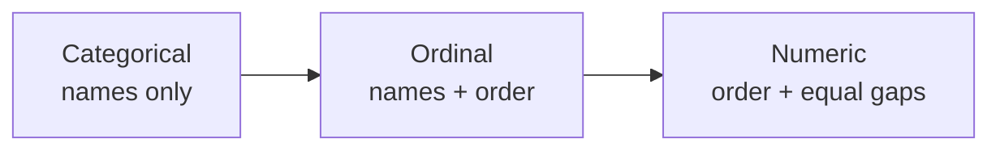

# Ordinal Variable

Think of a race. First, second and third tell you the order the runners finished, but not whether the winner was ahead by a nose or by a full minute. An **ordinal variable** is like that: it sorts things into named *categories* (also called *levels*) that have a natural order, but the size of the gaps between them is unknown. [[Fire History Variables|Burn severity]] recorded as low, medium or high is ordinal. So are age classes such as juvenile, yearling and adult, and plant cover classes. It sits between two simpler kinds of data: a plain [[Categorical Variable]] has names with no order (species, for example), while a true number has both an order and equal, known gaps between values.

A small example shows what you can and cannot do. Burn severity on six plots reads low, low, medium, high, medium, low. You can say high is worse than medium and medium worse than low. You can find a [[Median|middle value]]: sorted, the list is low, low, low, medium, medium, high, so the median falls between low and medium. What you cannot honestly do is arithmetic. If you code the levels as 1, 2 and 3 and take an average, you are quietly claiming that the step from low to medium is exactly as big as the step from medium to high. Nothing in the field measurement said so; the codes are labels and their spacing is your invention.

Why do ordinal scales exist at all? Because field measurement is often coarse. An observer can reliably say "more cover" long before they can say "37% cover", and an ordinal scale records that honestly. When you analyse one, you have three choices: treat the levels as unordered categories (safe, but it ignores the order), treat them as numbers (simple, but it assumes equal steps), or use an ordinal model that keeps the order without assuming the spacing. In R, store them as an ordered factor ([[Factors in R]]); otherwise R sorts the levels alphabetically, which here would put high before low and medium. Rank-based tools such as [[Spearman Rank Correlation]] also respect order without assuming equal gaps.


*What to look at:* ordinal data sit between names and numbers.

```r
sev <- c("low", "low", "medium", "high", "medium", "low")
sev_f <- factor(sev, levels = c("low", "medium", "high"), ordered = TRUE)
sev_f                # Levels: low < medium < high
table(sev_f)         # counts in the right order
sev_f[1] < sev_f[4]  # TRUE: comparisons work
median(as.integer(sev_f))   # 1.5, between low and medium
```
Setting `levels` fixes the order. Without it R sorts alphabetically (high, low, medium).

## Connections
- **Builds on:** [[Categorical Variable]], [[Variable]], [[Median]]
- **Leads to:** [[Factors in R]], [[Dummy Coding]], [[Spearman Rank Correlation]], [[Fire History Variables]]
- **Part of:** [[MOC 01 - Basics from Zero|MOC - Basics from Zero]]

## Flashcards

What is an ordinal variable?
??
A categorical variable whose levels have a natural order but unknown spacing.
++++

Why is taking the mean of an ordinal variable coded 1, 2, 3 risky?
??
It assumes the gaps between levels are equal, which the scale never measured.
++++

How do you make R respect the order of levels?
??
Use factor(x, levels = c(...), ordered = TRUE), otherwise levels sort alphabetically.
++++
