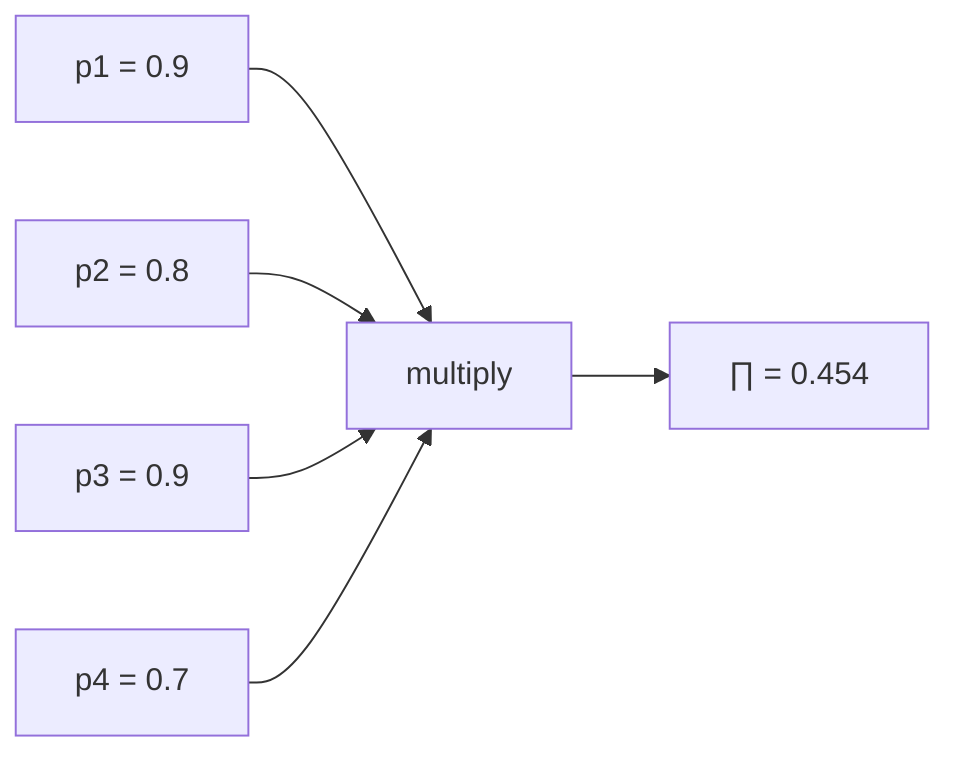

# Product Notation

A door has three locks, each left open with its own chance: 0.5, 0.4 and 0.2. A burglar gets in only if all three are open, and the chance of that is 0.5 × 0.4 × 0.2 = 0.04. "Multiply every chance on the list" is exactly what **product notation** says. The symbol ∏, a capital Greek pi (P for "product"), is shorthand for "multiply all of these together", just as Σ means "add all of these up" ([[Summation Notation]]). The numbers written below and above it give the index range: $\prod_{i=1}^{n} p_i$ reads "for i from 1 to n, multiply p-i into the running total". Do not confuse capital ∏ with the lower-case π, the circle constant 3.14.

Two examples. Four nest boxes hold 4, 7, 2 and 5 eggs; $\prod_{i=1}^{4} x_i$ = 4 × 7 × 2 × 5 = 280. More usefully, four nests each survive with chances 0.9, 0.8, 0.9 and 0.7, so the chance that all four survive is 0.9 × 0.8 × 0.9 × 0.7 = 0.454. Multiplying chances like this is only allowed when the events are *independent*, meaning one happening does not change the chance of another ([[Independence of Observations|Independence]]); the notation does not check that for you, and dependent events need conditional probabilities instead ([[Conditional Probability]]).

Products appear whenever several independent things must all happen, and the most important case is the [[Likelihood]]: the probability of a whole dataset under a model is each observation's probability multiplied together, a ∏ over the observations ([[Hobbs and Hooten 2015 Ch3]]). That creates a practical problem. Multiply 500 probabilities of 0.01 and the answer is so small that the computer rounds it to 0. The cure is the [[Logarithm]], which turns a product into a sum: $\log \prod p_i = \sum \log p_i$. The logs of those 500 probabilities add to a perfectly manageable −2,303. That is why software always works with log-likelihoods. The notation itself is just one of the road signs in [[Greek Letters and Notation]], short for a loop that multiplies everything on the list.


*What to look at:* ∏ is one loop that multiplies everything on the list.

```r
x <- c(4, 7, 2, 5)
prod(x)                          # 280
prod(c(0.9, 0.8, 0.9, 0.7))      # 0.4536: all four nests survive
prod(rep(0.01, 500))             # 0: too tiny for the computer
sum(log(rep(0.01, 500)))         # -2302.6: the log version is fine
```

## Connections
- **Builds on:** [[Summation Notation]], [[Greek Letters and Notation]]
- **Leads to:** [[Likelihood]], [[Independence of Observations|Independence]], [[Logarithm]]
- **Part of:** [[MOC 01 - Basics from Zero|MOC - Basics from Zero]]
- **Go deeper:** [[Hobbs and Hooten 2015 Ch3]]

## Flashcards

What does ∏ mean, and where does it show up in modeling?
??
Multiply all the terms together. The likelihood of independent observations is the product of their individual probabilities.
++++

Why does software use the log-likelihood instead of the likelihood?
??
The log turns a product of many tiny probabilities into a sum, which is easier to compute and doesn't underflow to zero.
++++
