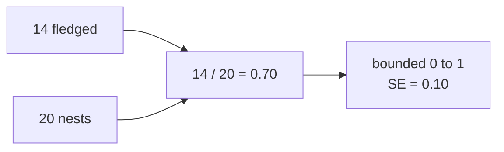

# Proportion

Picture a pizza cut into 8 slices. If you eat 3, you ate 3/8 = 0.375 of it. You cannot eat less than none or more than all of it, so the answer is trapped between 0 and 1. A **proportion** is a part divided by its whole: the part is the *numerator* (the number of "successes") and the whole is the *denominator* (the number of trials). Multiply by 100 and you have a percentage. Survival, detection, germination and occupancy are all proportions in disguise, because they answer "how many out of how many?"

A worked example. You monitor 20 nests and 14 fledge young. The proportion successful is 14 / 20 = 0.70, or 70%, and the proportion that failed is 0.30. Now compare that with watching only 2 nests and seeing 1 succeed: you get 0.50, but you would trust it far less. This is the key point about proportions: the bare fraction hides how much evidence stands behind it. Each trial is one piece of evidence, so the [[Standard Error|standard error]], the typical size of the error in the estimate, is √(p(1 − p)/n). For the 20 nests that is √(0.7 × 0.3 / 20) = 0.10. With 200 nests and the same 0.70 it would be about 0.03. That is why you should always keep both counts, the successes and the trials, and not just the ratio.

Because a proportion is fenced in at 0 and 1, straight lines and bell curves misbehave near those fences: a [[Equation of a Line|straight line]] will happily predict 110% survival, and the spread of a proportion shrinks as it nears 0 or 1 instead of staying constant. So proportions get a model built for them, the [[Binomial Distribution]], usually with a logit link that keeps predictions inside the fence ([[Binomial GLM for Proportions]]). One confusion is worth clearing up: a proportion is what you *observed*, while a [[Probability]] is the underlying chance that produced it. The 0.70 from your 20 nests is an estimate of the nest-success probability, not the probability itself. Proportions can also be rewritten as [[Odds]], which is the step that leads to [[Logistic Regression|logistic regression]].


*What to look at:* two counts go in, one bounded number comes out.

```r
fledged <- 14; nests <- 20
p <- fledged / nests                 # 0.70
se <- sqrt(p * (1 - p) / nests)      # 0.10
c(p, se)
# a binomial model uses both counts
m <- glm(cbind(fledged, nests - fledged) ~ 1, family = binomial)
plogis(coef(m))                      # 0.70 again
```
`cbind(successes, failures)` tells R how many trials stand behind the proportion.

## Connections
- **Builds on:** [[Count Data]], [[Binary Variable]], [[Standard Error]], [[Equation of a Line]]
- **Leads to:** [[Probability]], [[Binomial Distribution]], [[Odds]], [[Binomial GLM for Proportions]], [[Logistic Regression]]
- **See also:** [[Logit Link]], [[Powell and Gale 2015 Ch2]]
- **Part of:** [[MOC 01 - Basics from Zero|MOC - Basics from Zero]]

## Flashcards

What is a proportion?
??
A part divided by its whole, always between 0 and 1.
++++

Why must you keep the denominator of a proportion?
??
It says how many trials back the number, which sets its precision.
++++

What is the standard error of a proportion p from n trials?
??
√(p(1 − p)/n).
++++
