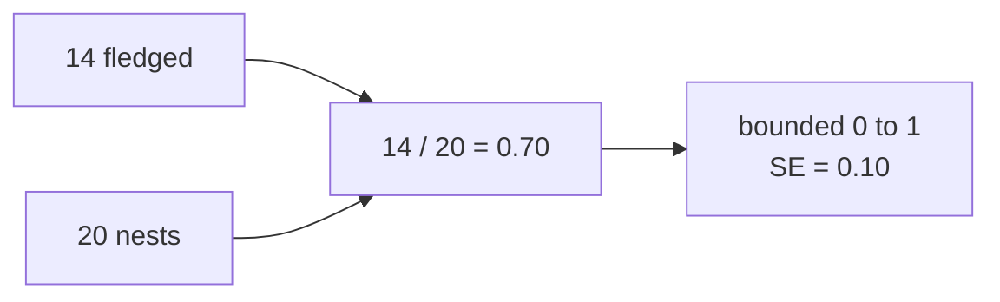

# Proportion

**In one line:** a proportion is a part divided by its whole, so it always lies between 0 and 1.

> [!info] Before this, it helps to know
> [[Count Data]] (the part and the whole are counts) · [[Binary Variable]] (yes or no outcomes)

## The everyday picture
A pizza cut into 8 slices. If you eat 3, you ate 3/8 = 0.375 of the pizza. You can't eat less than none or more than all of it, so the answer is trapped between 0 and 1.

*Where the picture stops working:* 3 of 8 slices and 300 of 800 slices give the same proportion, but the second is known far more precisely. A proportion alone hides how much data stand behind it.

## Words you'll need
- **Numerator:** the part (successes).
- **Denominator:** the whole (trials).
- **Percentage:** a proportion multiplied by 100.

## A tiny example
20 nests are monitored and 14 fledge young.
- Proportion successful = 14 / 20 = **0.70**, or 70%.
- Proportion failed = 1 − 0.70 = **0.30**.
- With only 2 nests and 1 success you would get 0.50, a far shakier number.

## Start from zero
1. **Count the successes and the trials.** 14 and 20.
2. **Divide.** The proportion is successes / trials.
3. **It is bounded.** It cannot go below 0 or above 1.
4. **Its wobble depends on the denominator.** *Why:* each trial is one piece of evidence. SE = √(p(1 − p)/n), here √(0.7 × 0.3 / 20) = 0.10.
5. **So keep both numbers.** Models for proportions use successes and failures, not the bare fraction ([[Binomial Distribution]]).

## See it

*What to look at:* two counts go in, one bounded number comes out.

## Why it is this way
Survival, detection, germination and occupancy are all "how many out of how many". Because the answer is fenced in at 0 and 1, straight lines and bell curves break near the fences. That is why proportions get the binomial distribution and the logit link ([[Logit Link]]).

## In R
```r
fledged <- 14; nests <- 20
p <- fledged / nests                 # 0.70
se <- sqrt(p * (1 - p) / nests)      # 0.10
c(p, se)
# a binomial model uses both counts
m <- glm(cbind(fledged, nests - fledged) ~ 1, family = binomial)
plogis(coef(m))                      # 0.70 again
```
`cbind(successes, failures)` tells R how many trials stand behind the proportion.

## In the course
Powell and Gale build survival estimates from proportions ([[Powell and Gale 2015 Ch2]]). Homework 2 models the proportion of coral bleaching events ([[Course Website]]).

## Common confusions
- **"A proportion is continuous, so use the normal."** It is bounded and its variance depends on its mean.
- **"Proportion and probability are the same."** A proportion is what you observed. A probability is the underlying chance that produced it ([[Probability]]).

## Explain it back
- Why is 1 of 2 less convincing than 50 of 100?
- Why can't a straight line model a proportion well near 0 or 1?

*Pass test:* you can compute a proportion and its standard error and say why the denominator matters.

## Connections
- **Builds on:** [[Count Data]], [[Binary Variable]]
- **Leads to:** [[Probability]], [[Binomial Distribution]], [[Odds]], [[Binomial GLM for Proportions]]
- **Part of:** [[MOC 01 - Basics from Zero|MOC - Basics from Zero]]

## Flashcards

What is a proportion?
??
A part divided by its whole, always between 0 and 1.
++++

Why must you keep the denominator of a proportion?
??
It says how many trials back the number, which sets its precision.
++++

What is the standard error of a proportion p from n trials?
??
√(p(1 − p)/n).
++++
