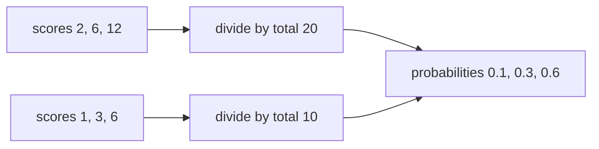

# Proportional To

Double the guests, double every ingredient: in a recipe the amounts are proportional to the number of guests. "y is **proportional to** x", written y ∝ x, means y equals x times some fixed number, y = c·x, so doubling x doubles y. The fixed multiplier c is the *constant of proportionality*. Proportional does not mean equal; it means equal up to that multiplier. And a line with an intercept, [[Linear Function|y = a + bx]], is proportional only if a = 0, because with an intercept doubling x does not double y.

The useful property is that ratios survive. Suppose three hypotheses have "scores" 2, 6 and 12 that are proportional to their probabilities. You do not know c, but probabilities must add to 1, so you can recover it: divide each score by the total, 20, to get 0.1, 0.3 and 0.6. This [[Scaling Predictors|rescaling]] so the total is 1 is called *normalizing*. Halve every score to 1, 3 and 6 and you get exactly the same probabilities, because the constant cancels. And to compare two of them, you do not need c at all: the third is 12 / 2 = 6 times as probable as the first, whatever c is.

This is why ∝ is everywhere in [[Bayesian Inference|Bayesian statistics]]. Bayes' theorem is usually written posterior ∝ likelihood × prior ([[Bayes' Theorem]]). The missing constant is the [[Marginal Likelihood]], an integral that is usually impossible to compute, but the shape of the posterior is cheap to calculate, and methods such as the [[Metropolis Algorithm]] only ever compare two values by their ratio, so the constant cancels and is never needed ([[Normalizing Constant]]). Likelihoods are likewise only defined up to a constant ([[Likelihood]]), and Hobbs and Hooten write posteriors with ∝ from Chapter 5 onward ([[Hobbs and Hooten 2015 Ch5]]). A quick check: if y ∝ x and y = 12 when x = 4, then c = 3 and y = 30 when x = 10 ([[Functions in Maths]], [[Rate of Change]]).


*What to look at:* different constants, same final answer.

```r
score <- c(2, 6, 12)
score / sum(score)          # 0.1 0.3 0.6
(score / 2) / sum(score / 2)  # identical: the constant cancels
score[3] / score[1]         # 6: ratios don't need the constant
```
Normalizing removes whatever constant the scores were multiplied by.

## Connections
- **Builds on:** [[Functions in Maths]]
- **Leads to:** [[Bayes' Theorem]], [[Normalizing Constant]], [[Likelihood]], [[Linear Function]], [[Scaling Predictors]], [[Bayesian Inference]]
- **Part of:** [[MOC 01 - Basics from Zero|MOC - Basics from Zero]]

## Flashcards

What does y ∝ x mean?
??
y equals x times a fixed constant, so ratios of y match ratios of x.
++++

Why can constants be dropped when comparing two values of a proportional quantity?
??
The constant multiplies both, so it cancels in the ratio.
++++

How is Bayes' theorem written with ∝?
??
Posterior ∝ likelihood × prior.
++++
