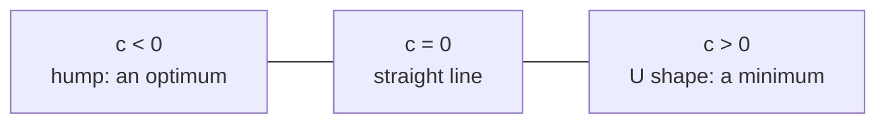

# Quadratic Term

Throw a ball and watch it climb, slow, top out and come down. Many ecological responses behave the same way along a gradient: too cold is bad, too hot is bad, and somewhere in the middle is best. A **quadratic term** is an x² added to a model, y = a + bx + cx², so the response can rise to a peak and fall, or fall to a trough and rise. The x value where the response peaks is the *optimum*. The sign of c decides the shape: negative c gives a hump (the curve is *concave down*), positive c gives a U, and c = 0 gives back a straight line.

Why does adding x² create a turning point? In a straight line the [[Slope]] is the same everywhere, so the line can only go up or only go down. With the squared term, the slope at any point becomes b + 2cx, so it changes as x changes. With negative c the slope shrinks as x grows, passes through zero, and turns negative. The turning point is where the slope equals zero: x = −b / (2c) ([[Derivative]]). Example: crab size = 5 + 4·lat − 0.5·lat². At lat = 2 the size is 11, at lat = 4 it is 13, and at lat = 6 it is 11 again. The peak is at −4 / (2 × −0.5) = 4. The course's model selection lab fits exactly this kind of quadratic effect of latitude on fiddler crab size.

Three cautions keep you out of trouble. First, once x² is in the model, b no longer means "the effect of x", because the effect depends on where you stand on x. Second, keep the plain x term whenever x² is in the model, even if x looks unimportant on its own; dropping it forces the peak or trough to sit at x = 0. Third, a clear x² does not prove there is an optimum in nature: the calculated peak may lie outside your data, where you only saw one side of the curve. In real analyses, centre x before squaring it, because x and x² are strongly correlated otherwise ([[Centering]]). The quadratic is popular because it is the simplest function with a turning point that still keeps the model linear in its parameters, so every lm, glm and mixed-model tool still works; for shapes it cannot capture, such as lopsided peaks, see [[Smoother]]. When the slope of x depends on another variable instead of on x itself, you need an [[Interaction Term]].


*What to look at:* the sign of the squared coefficient decides hump or U.

```r
set.seed(2)
lat <- runif(60, 0, 8)
size <- 5 + 4 * lat - 0.5 * lat^2 + rnorm(60, 0, 1)
m <- lm(size ~ lat + I(lat^2))
b <- coef(m)
-b["lat"] / (2 * b["I(lat^2)"])     # estimated optimum, close to 4
```
Centre lat first in real analyses, because lat and lat² are strongly correlated ([[Centering]]).

## Connections
- **Builds on:** [[Polynomial]], [[Slope]]
- **Leads to:** [[Interaction Term]], [[Derivative]], [[Smoother]]
- **Part of:** [[MOC 01 - Basics from Zero|MOC - Basics from Zero]]

## Flashcards

What does adding x² to a model allow?
??
A single peak or trough in the response.
++++

Where is the turning point of y = a + bx + cx²?
??
At x = −b / (2c).
++++

Why keep the linear term when a quadratic term is included?
??
Removing it forces the peak or trough to sit at x = 0.
++++
