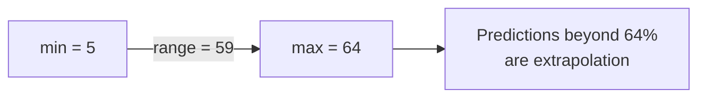

# Range

Think of the coldest and warmest days of the year. "From −5 to 35 degrees" tells you the extremes you must be ready for, though not what a typical day is like. The **range** of a dataset is the distance from its smallest value (the *minimum*) to its largest (the *maximum*), the full stretch the data cover. People report it either as one number, maximum minus minimum, or as the pair "from 5 to 64". Note that R's `range()` returns the pair, not the difference.

Tree cover on 6 plots is 5, 12, 18, 20, 31 and 64 percent. The range is 64 − 5 = 59 percentage points. Drop the single plot with 64% and it falls to 26, so one plot made more than half of it. This is the range's weakness: it rests on just two observations and ignores everything in between, so one odd value sets it. It also grows with sample size, because more data means more chances to catch an extreme, just as more years of weather records can only widen the record temperatures. That is why it is a poor summary of typical spread, and why the [[Interquartile Range]] and the standard deviation exist. A wide range does not prove high variability; one stray value can stretch the range of otherwise tight data.

Yet the range is one of the most useful first checks there is. Looking at it for every variable answers two questions. Are the values even possible (a tree cover of 164% means a data-entry error)? That is step one of Zuur's protocol ([[Data Exploration Protocol]]), and the reason to look at every extreme value as a possible [[Outlier]]. And how far can the model's conclusions stretch? The range of a predictor is the fence around what you observed; a prediction for a plot with 90% tree cover, when your data stop at 64%, is a guess, called [[Extrapolation]].


*What to look at:* the range is the fence around what you observed.

```r
tree <- c(5, 12, 18, 20, 31, 64)
range(tree)          # 5 64: R returns the two ends
diff(range(tree))    # 59: the range as one number
diff(range(tree[tree < 64]))   # 26 without the largest plot
```
Always look at `range()` or `summary()` of each variable before modeling.

## Connections
- **Builds on:** [[Observation]]
- **Leads to:** [[Interquartile Range]], [[Outlier]], [[Extrapolation]]
- **See also:** [[Variance]]
- **Part of:** [[MOC 01 - Basics from Zero|MOC - Basics from Zero]]

## Flashcards

What is the range of a dataset?
??
The maximum minus the minimum, or the pair of values themselves.
++++

Why is the range a fragile measure of spread?
??
It depends on only the two most extreme observations.
++++

What does R's range() return?
??
The minimum and the maximum, not their difference.
++++
