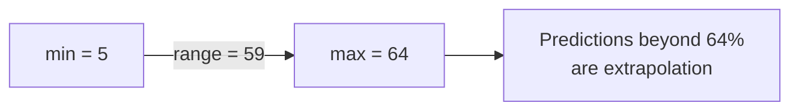

# Range

**In one line:** the range is the distance from the smallest value to the largest, the full stretch the data cover.

> [!info] Before this, it helps to know
> [[Observation]] (a measured value) · [[Variance]] (another measure of spread)

## The everyday picture
The coldest and warmest days of the year. "From −5 to 35 degrees" tells you the extremes you must be ready for, though not what a typical day is like.

*Where the picture stops working:* more years of records can only widen the extremes, so a range depends on how long you looked.

## Words you'll need
- **Minimum, maximum:** the smallest and largest values.
- **Spread:** how far apart the data are.
- **Extrapolation:** predicting outside the range of the data ([[Extrapolation]]).

## A tiny example
Tree cover on 6 plots: 5, 12, 18, 20, 31, 64 percent.
- Minimum 5, maximum 64.
- Range = 64 − 5 = **59** percentage points.
- Drop the plot with 64 and the range falls to 26. One plot made more than half of it.

## Start from zero
1. **Find the smallest and largest values.**
2. **Subtract.** That is the range as one number. People also report it as the pair "5 to 64".
3. **It rests on just two observations.** *Why:* everything in between is ignored, so one odd value sets it.
4. **It grows with sample size.** More data means more chances for an extreme.
5. **It marks the edge of what your model knows.** Predictions outside the range of a predictor are guesses.

## See it

*What to look at:* the range is the fence around what you observed.

## Why it is this way
The range is the quickest check there is: are the values even possible (a cover of 164%?), and how far can the model's conclusions stretch? It is a poor summary of typical spread because it is fragile, which is why the interquartile range and standard deviation exist.

## In R
```r
tree <- c(5, 12, 18, 20, 31, 64)
range(tree)          # 5 64: R returns the two ends
diff(range(tree))    # 59: the range as one number
diff(range(tree[tree < 64]))   # 26 without the largest plot
```
Always look at `range()` or `summary()` of each variable before modeling.

## In the course
Step 1 of Zuur's protocol is hunting for impossible or extreme values ([[Data Exploration Protocol]]). The linear models lab warns against predicting beyond the observed range ([[Course Website]]).

## Common confusions
- **"range() gives one number."** In R it gives the minimum and maximum.
- **"A wide range means high variability."** One stray value can make a wide range in otherwise tight data.

## Explain it back
- Why is the range sensitive to sample size?
- How does the range of a predictor limit your predictions?

*Pass test:* you can compute a range and explain why it is fragile.

## Connections
- **Builds on:** [[Observation]]
- **Leads to:** [[Interquartile Range]], [[Outlier]], [[Extrapolation]]
- **Part of:** [[MOC 01 - Basics from Zero|MOC - Basics from Zero]]

## Flashcards

What is the range of a dataset?
??
The maximum minus the minimum, or the pair of values themselves.
++++

Why is the range a fragile measure of spread?
??
It depends on only the two most extreme observations.
++++

What does R's range() return?
??
The minimum and the maximum, not their difference.
++++
