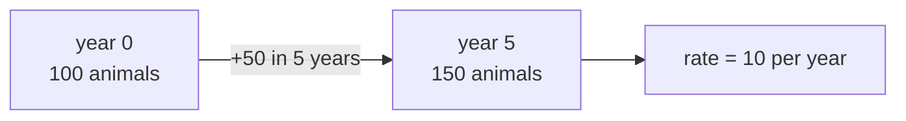

# Rate of Change

A car travels 120 km in 2 hours, so its speed is 60 km per hour: distance changing per unit of time. A **rate of change** says how much one quantity changes for each unit change in another, and the word "per" is its signature. It is written Δy / Δx, where Δ (the Greek letter delta) means "change in". Time is not required; any "per" works: grams per millimetre, species per degree, birds per metre of elevation. A *per capita* rate divides by the number of individuals, such as births per female.

A population is 100 animals in year 0 and 150 in year 5. The change in animals is Δy = 50 and the change in time is Δx = 5 years, so the average rate of change is 50 / 5 = 10 animals per year. Per capita that is 10 / 100 = 0.10 per animal per year at the start. For a straight line the rate is the same everywhere: it is the line's [[Slope]]. For a curve, each stretch has its own rate, because the curve steepens or flattens as you move along it. The 10 per year is an average over the five years; the rate at one instant, like a speedometer reading, is the [[Derivative]]. Rates also carry units, and a slope with no units stated cannot be interpreted.

Ecology is about change (growth, decline, spread, response to a gradient), and a rate turns two snapshots into a statement about a process. It is also exactly what a regression coefficient is: the estimated change in the response per one-unit change in the predictor, which is why `lm()` on these two points returns a slope of 10. Guthery and Bingham's paper is largely about reading regression slopes as rates correctly ([[Guthery and Bingham 2007]]), and the [[Population Growth Rate]] is the central rate in Powell and Gale ([[Powell and Gale 2015 Ch1]]). Remember that an average rate holds at every point only for straight-line relationships ([[Functions in Maths]]).


*What to look at:* rise over run.

```r
N <- c(100, 150); t <- c(0, 5)
diff(N) / diff(t)                 # 10 animals per year
diff(N) / diff(t) / N[1]          # 0.10 per capita
# the slope of a regression is an estimated rate of change
coef(lm(N ~ t))["t"]              # 10
```
A slope from `lm()` is an average rate of change.

## Connections
- **Builds on:** [[Functions in Maths]]
- **Leads to:** [[Slope]], [[Derivative]], [[Population Growth Rate]]
- **Part of:** [[MOC 01 - Basics from Zero|MOC - Basics from Zero]]

## Flashcards

What is a rate of change?
??
The change in one quantity divided by the change in another: Δy / Δx.
++++

How is a regression slope a rate?
??
It is the estimated change in the response per one-unit change in the predictor.
++++

When is the rate of change the same everywhere?
??
Only when the relationship is a straight line.
++++
