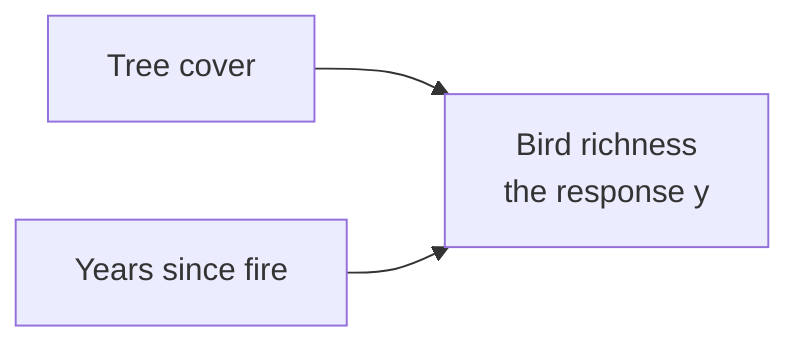

# Response Variable

Imagine a row of plants on a windowsill, some taller than others. You want to know why. Height is the outcome you care about, and water, light and pot size are the things that might cause it. The **response variable** is that outcome: the thing a model tries to explain or predict, usually written **y**. The other variables, the possible causes, are [[Explanatory Variable]]s, written x. For the plants the direction is obvious, but with field data choosing the response is a decision you make from your question. Phrase the question as "what affects ___?" and whatever fills the blank is the response.

A concrete case: five plots have tree cover of 10, 20, 30, 40 and 50 percent and hold 9, 8, 6, 5 and 3 grassland bird species. The question "does tree cover reduce bird richness?" makes bird richness the response. In R's model formula, the response goes on the left of the tilde, `birds ~ tree`, which reads "birds depends on tree" ([[Model Formula Syntax]]), and it goes on the vertical axis of a graph. Fitting a straight line to these numbers gives an intercept of 10.7 and a slope of −0.15, so each extra 10% of tree cover goes with 1.5 fewer species in these made-up data ([[Linear Regression]]).

Why does it matter so much which variable is the response? Because a statistical model is lopsided on purpose. Only the response is treated as random, with a probability distribution describing how it scatters around the model's prediction. The explanatory variables are treated as known. So the response's type decides the whole model: counts scatter differently from proportions, which scatter differently from body masses, and each needs its own distribution ([[Why the response type decides the distribution]]). That is why Zuur's data exploration protocol looks at the response first ([[Zuur et al. 2010]]). It also clears up a common worry: the explanatory variables do not need to be normally distributed. Distribution assumptions are about the response given the predictors, and you check them through the [[Residual]]s.


*What to look at:* arrows point into the response, never out of it.

```r
d <- data.frame(tree = c(10, 20, 30, 40, 50), birds = c(9, 8, 6, 5, 3))
m <- lm(birds ~ tree, data = d)   # response on the left of ~
coef(m)                           # intercept 10.7, slope -0.15
plot(birds ~ tree, data = d)      # response on the vertical axis
```
Each extra 10% of tree cover goes with 1.5 fewer species in these made-up data.

## Connections
- **Builds on:** [[Variable]]
- **Leads to:** [[Explanatory Variable]], [[Linear Regression]], [[Model Formula Syntax]]
- **See also:** [[Model]]
- **Part of:** [[MOC 01 - Basics from Zero|MOC - Basics from Zero]]

## Flashcards

What is the response variable?
??
The outcome the model tries to explain or predict, written y, on the left of ~.
++++

Which variable gets a probability distribution in a regression?
??
The response. Explanatory variables are treated as known.
++++

Why check the type of the response first?
??
Counts, proportions and continuous values need different distributions.
++++
