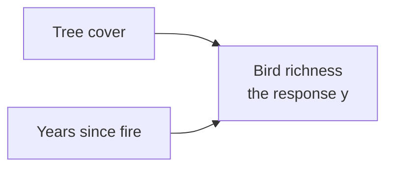

# Response Variable

**In one line:** the response variable is the thing you are trying to explain or predict, written y.

> [!info] Before this, it helps to know
> [[Variable]] (a column of data) · [[Model]] (a simplified description)

## The everyday picture
A plant on a windowsill. You want to know why some plants grow taller. Height is the outcome you care about. Water, light and pot size are things that might cause it. Height is the response.

*Where the picture stops working:* for the plant the direction of cause is obvious. In field data, which variable is the response is a decision you make from your question.

## Words you'll need
- **y:** the usual symbol for the response.
- **Explanatory variable:** something used to explain the response ([[Explanatory Variable]]).
- **Formula:** R's way of writing "y depends on x", `y ~ x`.

## A tiny example
Five plots: tree cover 10, 20, 30, 40, 50 percent; grassland bird species 9, 8, 6, 5, 3.
- Question: does tree cover reduce bird richness?
- Response: **bird richness** (the outcome).
- Explanatory variable: tree cover.

## Start from zero
1. **State the question.** "What affects bird richness?"
2. **The thing after "affects" is the response.** It goes on the left of the `~` and on the vertical axis.
3. **Look at its type.** Count, proportion, yes or no, or continuous.
4. **The type picks the distribution.** *Why:* the model must describe how the response scatters, and counts scatter differently from masses ([[Why the response type decides the distribution]]).

## See it

*What to look at:* arrows point into the response, never out of it.

## Why it is this way
A statistical model is lopsided on purpose. Only the response is treated as random, with a probability distribution. The explanatory variables are treated as known. So choosing the response decides what the whole model is a model of.

## In R
```r
d <- data.frame(tree = c(10, 20, 30, 40, 50), birds = c(9, 8, 6, 5, 3))
m <- lm(birds ~ tree, data = d)   # response on the left of ~
coef(m)                           # intercept 10.7, slope -0.15
plot(birds ~ tree, data = d)      # response on the vertical axis
```
Each extra 10% of tree cover goes with 1.5 fewer species in these made-up data.

## In the course
Every lab starts by naming the response: richness, body mass, DBH, larvae presence ([[Course Website]]). Zuur's protocol checks the response first ([[Zuur et al. 2010]]).

## Common confusions
- **"The response is whatever column is last."** It is set by your question.
- **"Explanatory variables need to be normal."** Distribution assumptions are about the response given the predictors, mostly seen in the residuals ([[Residual]]).

## Explain it back
- In "does rainfall affect seed set?", which is the response?
- Why does the response's type matter more than the predictors' types?

*Pass test:* you can pick the response in any study description.

## Connections
- **Builds on:** [[Variable]]
- **Leads to:** [[Explanatory Variable]], [[Linear Regression]], [[Model Formula Syntax]]
- **Part of:** [[MOC 01 - Basics from Zero|MOC - Basics from Zero]]

## Flashcards

What is the response variable?
??
The outcome the model tries to explain or predict, written y, on the left of ~.
++++

Which variable gets a probability distribution in a regression?
??
The response. Explanatory variables are treated as known.
++++

Why check the type of the response first?
??
Counts, proportions and continuous values need different distributions.
++++
