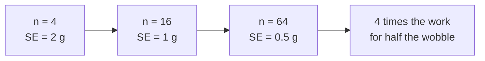

# Sample Size

Think about tasting a pot of soup. One spoonful tells you something about the pot, ten spoonfuls from different spots tell you much more, and the hundredth spoonful adds almost nothing new. **Sample size**, written **n**, is the number of spoonfuls: how many separate, *independent* things you measured. Independent means that one measurement tells you nothing about another beyond what the model already knows ([[Independence of Observations]]). Ten weighings of the same bird are not ten birds; they are one bird measured ten times, which is why only truly separate units count toward n ([[Pseudoreplication]]). Soup is well stirred, so a few spoonfuls are enough. Animals and plots differ far more from one another, so ecology needs much larger samples.

Here is why n matters, with numbers. Suppose sparrow masses vary with a [[Standard Deviation|standard deviation]] of 4 g. The **standard error** (SE) of the average, which is the typical distance between your sample average and the true average ([[Standard Error]]), is the standard deviation divided by the [[Square Root|square root]] of n. With 4 birds the SE is 4 / √4 = 2 g. With 16 birds it is 4 / √16 = 1 g. With 64 birds it is 0.5 g. Notice the pattern: every time you collect four times as many birds, the wobble in your answer only halves. The reason is that an average is a mix of lucky and unlucky draws, and averaging more draws cancels more luck. But random errors partly cancel each other instead of adding up, and that partial cancelling follows a square-root law. So going from 4 to 16 birds buys you as much as going from 16 to 64.

Sample size also limits how complicated a model you can afford. Every number a model has to estimate (a *parameter*) needs data to pin it down, and a common rule of thumb asks for at least 10 observations per parameter. With small n you are pushed toward simpler models and toward corrections built for small samples, such as [[AICc]], and [[Random Effect|random effects]] need enough groups to work ([[How Many Levels for a Random Effect]]). Two traps are worth naming. More rows do not automatically mean a bigger n, because rows from the same plot or animal are not independent. And a big n does not fix everything: it shrinks random wobble, but a method that is biased stays biased no matter how much data you feed it ([[Bias]]).


*What to look at:* the work grows by multiplying while the precision improves by a square root.

```r
sd_mass <- 4
n <- c(4, 16, 64)
sd_mass / sqrt(n)        # 2.0 1.0 0.5

# check by simulation: the spread of many sample means
set.seed(1)
sapply(n, function(k) sd(replicate(5000, mean(rnorm(k, 20, sd_mass)))))
```
The simulated spreads land close to 2, 1 and 0.5.

## Connections
- **Builds on:** [[Sample]], [[Observation]], [[Standard Deviation]], [[Square Root]]
- **Leads to:** [[Standard Error]], [[Pseudoreplication]], [[AICc]], [[Random Effect]]
- **See also:** [[Powell and Gale 2015 Ch2]]
- **Part of:** [[MOC 01 - Basics from Zero|MOC - Basics from Zero]], molecular note [[Population and Sample]]

## Flashcards

What is sample size (n)?
??
The number of independent observations in the sample.
++++

Why does quadrupling n only halve the standard error?
??
SE = SD / √n, so precision improves with the square root of n.
++++

Why might 100 rows not mean n = 100?
??
Rows from the same animal, plot or time are not independent, so they carry less information than 100 separate units.
++++
