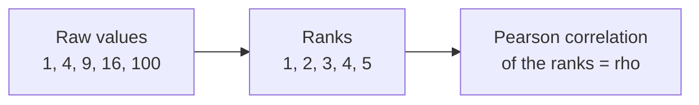

# Spearman Rank Correlation

**In one line:** Spearman rank correlation measures whether two variables rise together in any steady way, by correlating their ranks instead of their raw values.

> [!info] Before this, it helps to know
> [[Correlation]] (Pearson's straight-line measure) · [[Ordinal Variable]] (ordered data)

## The everyday picture
Two judges ranking the same 5 cakes. You don't care about their scores, only whether they put the cakes in the same order. If their orders match exactly, agreement is perfect, however differently they score.

*Where the picture stops working:* judges rank on purpose. Here you convert measurements to ranks yourself and throw away the distances.

## Words you'll need
- **Rank:** position after sorting, 1 for the smallest.
- **Monotonic:** always rising (or always falling), though not necessarily in a straight line.
- **ρ (rho):** the symbol for Spearman's coefficient, between −1 and 1.

## A tiny example
x = 1, 2, 3, 4, 5 and y = 1, 4, 9, 16, 100.
- y always rises with x, but not in a straight line.
- Ranks of x: 1, 2, 3, 4, 5. Ranks of y: 1, 2, 3, 4, 5. Identical.
- Spearman ρ = **1**. Pearson r = **0.79**, dragged down by the curve and the 100.

## Start from zero
1. **Replace each value by its rank** within its own variable.
2. **Compute the ordinary correlation of the ranks.** That is Spearman's ρ.
3. **Ranks ignore distances.** *Why:* 100 becomes simply "5th", so an extreme value can't dominate.
4. **So it detects any monotonic trend.** Curved but steadily increasing relationships score near 1.
5. **It still misses humps.** A relationship that rises then falls can give ρ near 0.

## See it

*What to look at:* ranking is the only extra step.

## Why it is this way
Pearson's correlation asks "how close to a straight line?" and is sensitive to outliers. Often you only want to know "do they go up together?". Ranking strips away shape and extremes, leaving just the ordering. It also makes sense for ordinal data, where distances were never known.

## In R
```r
x <- 1:5; y <- c(1, 4, 9, 16, 100)
cor(x, y)                         # 0.79 Pearson
cor(x, y, method = "spearman")    # 1
cor(rank(x), rank(y))             # 1: the same thing by hand
```
Spearman's ρ is literally Pearson's r applied to ranks.

## In the course
Used when screening predictors for [[Collinearity]] if relationships look curved or have outliers ([[Zuur et al. 2010]]).

## Common confusions
- **"ρ = 1 means a straight line."** It means a perfectly monotonic relationship of any shape.
- **"Spearman finds any relationship."** Not hump-shaped ones.

## Explain it back
- Why is Spearman's ρ 1 for y = x²  when x is positive?
- When would Pearson and Spearman disagree sharply?

*Pass test:* you can explain Spearman as "Pearson on ranks" and say what it does and doesn't detect.

## Connections
- **Builds on:** [[Correlation]], [[Ordinal Variable]]
- **Leads to:** [[Collinearity]], [[Pairplot]]
- **Part of:** [[MOC 01 - Basics from Zero|MOC - Basics from Zero]]

## Flashcards

How is Spearman's rank correlation computed?
??
Rank each variable, then take the ordinary Pearson correlation of the ranks.
++++

What kind of relationship gives Spearman ρ = 1?
??
Any perfectly increasing (monotonic) relationship, straight or curved.
++++

Why is Spearman less affected by outliers than Pearson?
??
Ranks record only order, so an extreme value counts as just the largest rank.
++++
