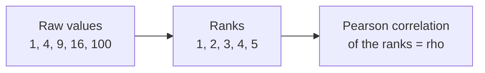

# Spearman Rank Correlation

Two judges each rank the same 5 cakes. You do not care about their scores, only whether they put the cakes in the same order. **Spearman rank correlation** works the same way: replace each value by its *rank* (its position after sorting, 1 for the smallest) within its own variable, then compute the ordinary Pearson [[Correlation]] of the ranks. The result, written ρ (the Greek letter rho), runs from −1 to 1. It measures whether two variables rise (or fall) together in any steady way. A relationship that always rises, though not necessarily in a straight line, is called *monotonic*.

An example shows the difference from Pearson. Let x = 1, 2, 3, 4, 5 and y = 1, 4, 9, 16, 100. y always rises with x, but not in a straight line, and the 100 is extreme. Ranks of x are 1, 2, 3, 4, 5 and ranks of y are also 1, 2, 3, 4, 5, identical, so Spearman ρ = 1. Pearson's r is 0.80, dragged down by the curve and by the 100. Ranking strips away both the shape and the extremes: 100 becomes simply "5th", so it cannot dominate. That makes Spearman a natural choice when you only want to know "do they go up together?", when there are outliers, and for [[Ordinal Variable]]s, where the distances between values were never known.

Know its limits. ρ = 1 means a perfectly monotonic relationship of any shape, not a straight line. And Spearman is not a detector of every relationship: a hump, rising then falling, can give ρ near 0 even when the link is strong. In the course it is a handy way to screen predictors for [[Collinearity]] when the scatterplots look curved or have outliers ([[Zuur et al. 2010]]), alongside a [[Pairplot]] that lets you see the shapes directly.


*What to look at:* ranking is the only extra step.

```r
x <- 1:5; y <- c(1, 4, 9, 16, 100)
cor(x, y)                         # 0.80 Pearson
cor(x, y, method = "spearman")    # 1
cor(rank(x), rank(y))             # 1: the same thing by hand
```
Spearman's ρ is literally Pearson's r applied to ranks.

## Connections
- **Builds on:** [[Correlation]], [[Ordinal Variable]]
- **Leads to:** [[Collinearity]], [[Pairplot]]
- **Part of:** [[MOC 01 - Basics from Zero|MOC - Basics from Zero]]

## Flashcards

How is Spearman's rank correlation computed?
??
Rank each variable, then take the ordinary Pearson correlation of the ranks.
++++

What kind of relationship gives Spearman ρ = 1?
??
Any perfectly increasing (monotonic) relationship, straight or curved.
++++

Why is Spearman less affected by outliers than Pearson?
??
Ranks record only order, so an extreme value counts as just the largest rank.
++++
