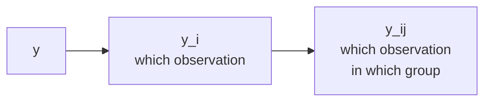

# Subscripts and Indexing

Think of house numbers on a street. "The house" could be any of them, but "house 7" is one exact building. A **subscript** is the house number for a measurement: a small lowered label that says which one you mean. If you weigh 4 voles and get 21, 25, 19 and 23 g, you can write y₁ = 21, y₂ = 25, y₃ = 19 and y₄ = 23. The letter that stands for "whichever one" is called the *index*, usually i, j, k or t. So yᵢ, read "y sub i", means "the response in row i", and "yᵢ for i = 1 to 4" means all four voles in turn.

The point of an index is that one short line can speak about every row at once. Writing yᵢ = a + b·xᵢ says the same rule holds for observation 1, observation 2 and all the rest, without writing it out 100 times. Data often need more than one label, just as an address needs a street as well as a house number. If voles 1 and 2 come from site A and voles 3 and 4 from site B, a second index names the group: yᵢⱼ, read "y sub i j", is observation i inside group j. Parameters can carry subscripts too: αⱼ means "the intercept for group j", one value per group. In R, square brackets do the same job: `y[3]` is y₃, and `y[site == "B"]` picks out every vole from site B ([[Indexing in R]]).

Reading subscripts tells you the structure of a model at a glance. Anything with an i varies from observation to observation, anything with a j varies from group to group, and anything with no subscript at all is one value shared by everyone. In yᵢⱼ = αⱼ + β·xᵢⱼ, each group has its own intercept αⱼ but all groups share one slope β. That is exactly a [[Random Intercept]] model, and this notation runs through the mixed-model and hierarchical readings ([[Hobbs and Hooten 2015 Ch6]], [[Harrison et al. 2018]]). Two common slips: i is not a particular number but a placeholder for any row, and a symbol with no subscript is not a mistake but a deliberate statement that the value is shared. Subscripts pair naturally with [[Summation Notation]], which adds up yᵢ over all i.


*What to look at:* each added subscript answers one more "which one?".

```r
y <- c(21, 25, 19, 23)
y[3]                         # 19: square brackets are R's subscripts
site <- c("A", "A", "B", "B")
y[site == "B"]               # 19 23: all observations in group B
for (i in 1:4) cat("y", i, "=", y[i], "\n")   # i runs over the rows
```
`y[i]` in R is yᵢ on paper.

## Connections
- **Builds on:** [[Greek Letters and Notation]], [[Observation]]
- **Leads to:** [[Summation Notation]], [[Indexing in R]], [[Random Intercept]]
- **Part of:** [[MOC 01 - Basics from Zero|MOC - Basics from Zero]]

## Flashcards

What does the subscript in yᵢ tell you?
??
Which observation is meant, with i standing for any row.
++++

What does yᵢⱼ usually mean in a mixed model?
??
Observation i inside group j.
++++

What does a parameter with no subscript mean?
??
One shared value for all observations and groups.
++++
